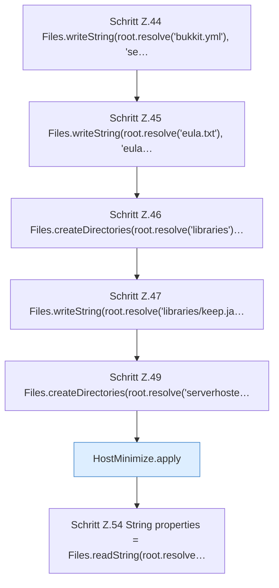

[[00 Start]] › [[Tests]] › [[HostMinimizeTest]] › [[HostMinimizeTest.Teil1]] › [[HostMinimizeTest.applyKeepsWorldSelectionChildBackupsAndSecurityKeys]] › [[HostMinimizeTest.applyKeepsWorldSelectionChildBackupsAndSecurityKeys.Teil2]]

# HostMinimizeTest.applyKeepsWorldSelectionChildBackupsAndSecurityKeys.Teil2



```knoten
Schritt Z.44 Files.writeString(root.resolve('bukkit.yml'), 'se…
  Zeile 44: schreibt Text in eine Datei. `Files.writeString(root.resolve('bukkit.yml'), 'se…`
Schritt Z.45 Files.writeString(root.resolve('eula.txt'), 'eula…
  Zeile 45: schreibt Text in eine Datei. `Files.writeString(root.resolve('eula.txt'), 'eula…`
Schritt Z.46 Files.createDirectories(root.resolve('libraries')…
  Zeile 46: Dateioperation. `Files.createDirectories(root.resolve('libraries')…`
Schritt Z.47 Files.writeString(root.resolve('libraries/keep.ja…
  Zeile 47: schreibt Text in eine Datei. `Files.writeString(root.resolve('libraries/keep.ja…`
Schritt Z.49 Files.createDirectories(root.resolve('serverhoste…
  Zeile 49: Dateioperation. `Files.createDirectories(root.resolve('serverhoste…`
HostMinimize.apply
  Das Verkleinern des [[Glossar#Host|Host]] wendet an das. Wendet an `apply`. Ruft `assertRoot`, `assertEditable`, `update`.
Schritt Z.54 String properties = Files.readString(root.resolve…
  Zeile 54: liest Text aus einer Datei. `String properties = Files.readString(root.resolve…`
```

> [!knoten]- Was die Blöcke tun
> - **Schritt Z.44 Files.writeString(root.resolve('bukkit.yml'), 'se…**: Zeile 44: schreibt Text in eine Datei. `Files.writeString(root.resolve('bukkit.yml'), 'se…`
> - **Schritt Z.45 Files.writeString(root.resolve('eula.txt'), 'eula…**: Zeile 45: schreibt Text in eine Datei. `Files.writeString(root.resolve('eula.txt'), 'eula…`
> - **Schritt Z.46 Files.createDirectories(root.resolve('libraries')…**: Zeile 46: Dateioperation. `Files.createDirectories(root.resolve('libraries')…`
> - **Schritt Z.47 Files.writeString(root.resolve('libraries/keep.ja…**: Zeile 47: schreibt Text in eine Datei. `Files.writeString(root.resolve('libraries/keep.ja…`
> - **Schritt Z.49 Files.createDirectories(root.resolve('serverhoste…**: Zeile 49: Dateioperation. `Files.createDirectories(root.resolve('serverhoste…`
> - **HostMinimize.apply**: Das Verkleinern des [[Glossar#Host|Host]] wendet an das. Wendet an `apply`. Ruft `assertRoot`, `assertEditable`, `update`.
> - **Schritt Z.54 String properties = Files.readString(root.resolve…**: Zeile 54: liest Text aus einer Datei. `String properties = Files.readString(root.resolve…`

- Ein weiterer Abschnitt derselben Übersicht.
- Fortsetzung von `HostMinimizeTest.applyKeepsWorldSelectionChildBackupsAndSecurityKeys`.
