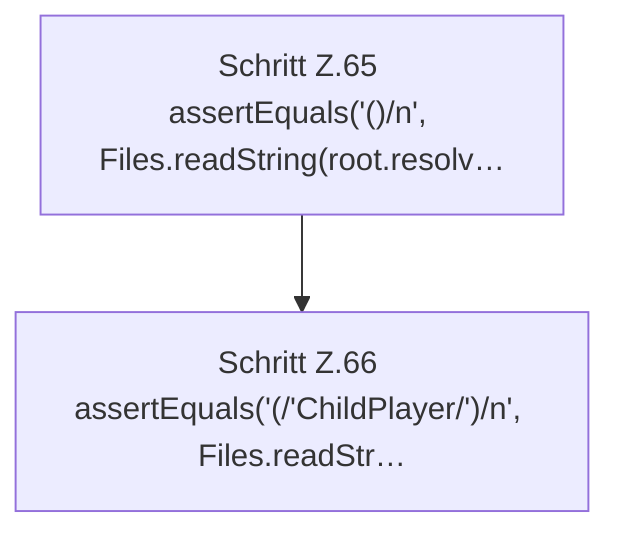

[[00 Start]] › [[Tests]] › [[HostMinimizeTest]] › [[HostMinimizeTest.Teil1]] › [[HostMinimizeTest.applyKeepsWorldSelectionChildBackupsAndSecurityKeys]] › [[HostMinimizeTest.applyKeepsWorldSelectionChildBackupsAndSecurityKeys.Teil3]]

# HostMinimizeTest.applyKeepsWorldSelectionChildBackupsAndSecurityKeys.Teil3



```knoten
Schritt Z.65 assertEquals('()/n', Files.readString(root.resolv…
  Zeile 65: liest Text aus einer Datei. `assertEquals('()/n', Files.readString(root.resolv…`
Schritt Z.66 assertEquals('(/'ChildPlayer/')/n', Files.readStr…
  Zeile 66: Dateioperation. `assertEquals('(/'ChildPlayer/')/n', Files.readStr…`
```

- Fortsetzung von `HostMinimizeTest.applyKeepsWorldSelectionChildBackupsAndSecurityKeys`, Quellreihenfolge.
