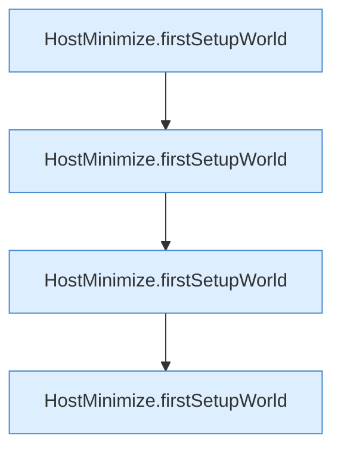

[[00 Start]] › [[Tests]] › [[HostMinimizeTest]] › [[HostMinimizeTest.Teil2]] › [[HostMinimizeTest.completedFirstSetupReconcilesMinimizationOnlyForLoadedLobby]]

# HostMinimizeTest.completedFirstSetupReconcilesMinimizationOnlyForLoadedLobby

`HostMinimizeTest.completedFirstSetupReconcilesMinimizationOnlyForLoadedLobby()` [src/test/java/de/aichele/childlauncher/HostMinimizeTest.java:289–296](https://github.com/Sciddie/minecraft-serverhoster-plugin/blob/95b02b953b0b4c23673e900e021a7c3c844aa37d/src/test/java/de/aichele/childlauncher/HostMinimizeTest.java#L289-L296)



```knoten
HostMinimize.firstSetupWorld
  Das Verkleinern des [[Glossar#Host|Host]] kümmert sich um die [[Glossar#Einrichtung|Einrichtung]] die [[Glossar#Spielwelt|Spielwelt]]. `firstSetupWorld` in `HostMinimize.java`. Ruft `lobbyNameSafe`.
```

> [!knoten]- Was die Blöcke tun
> - **HostMinimize.firstSetupWorld**: Das Verkleinern des [[Glossar#Host|Host]] kümmert sich um die [[Glossar#Einrichtung|Einrichtung]] die [[Glossar#Spielwelt|Spielwelt]]. `firstSetupWorld` in `HostMinimize.java`. Ruft `lobbyNameSafe`.

- Ein Schritt in einem [[Glossar#Probelauf|Probelauf]]. Er gehört nicht zum laufenden Server.
- `completedFirstSetupReconcilesMinimizationOnlyForLoadedLobby` in `src/test/java/de/aichele/childlauncher/HostMinimizeTest.java`
- Das ist ein Probelauf, kein Teil des laufenden Servers.
