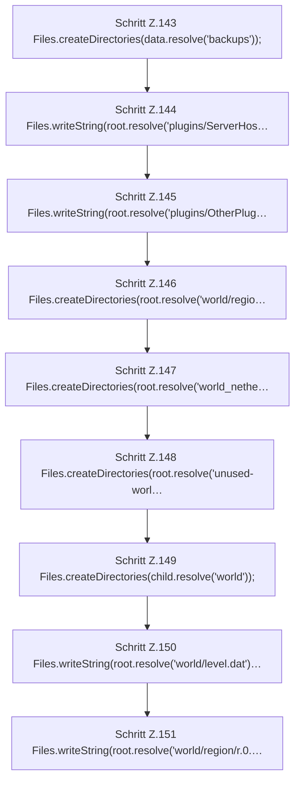

[[00 Start]] › [[Tests]] › [[HostMinimizeTest]] › [[HostMinimizeTest.Teil1]] › [[HostMinimizeTest.firstSetupClearsOnlyOuterWorldsAndCreatesTheVoidLobby]] › [[HostMinimizeTest.firstSetupClearsOnlyOuterWorldsAndCreatesTheVoidLobby.Teil1]]

# HostMinimizeTest.firstSetupClearsOnlyOuterWorldsAndCreatesTheVoidLobby.Teil1



```knoten
Schritt Z.143 Files.createDirectories(data.resolve('backups'));
  Zeile 143: Dateioperation. `Files.createDirectories(data.resolve('backups'));`
Schritt Z.144 Files.writeString(root.resolve('plugins/ServerHos…
  Zeile 144: schreibt Text in eine Datei. `Files.writeString(root.resolve('plugins/ServerHos…`
Schritt Z.145 Files.writeString(root.resolve('plugins/OtherPlug…
  Zeile 145: schreibt Text in eine Datei. `Files.writeString(root.resolve('plugins/OtherPlug…`
Schritt Z.146 Files.createDirectories(root.resolve('world/regio…
  Zeile 146: Dateioperation. `Files.createDirectories(root.resolve('world/regio…`
Schritt Z.147 Files.createDirectories(root.resolve('world_nethe…
  Zeile 147: Dateioperation. `Files.createDirectories(root.resolve('world_nethe…`
Schritt Z.148 Files.createDirectories(root.resolve('unused-worl…
  Zeile 148: Dateioperation. `Files.createDirectories(root.resolve('unused-worl…`
Schritt Z.149 Files.createDirectories(child.resolve('world'));
  Zeile 149: Dateioperation. `Files.createDirectories(child.resolve('world'));`
Schritt Z.150 Files.writeString(root.resolve('world/level.dat')…
  Zeile 150: schreibt Text in eine Datei. `Files.writeString(root.resolve('world/level.dat')…`
Schritt Z.151 Files.writeString(root.resolve('world/region/r.0.…
  Zeile 151: schreibt Text in eine Datei. `Files.writeString(root.resolve('world/region/r.0.…`
```

- Fortsetzung von `HostMinimizeTest.firstSetupClearsOnlyOuterWorldsAndCreatesTheVoidLobby`, Quellreihenfolge.
