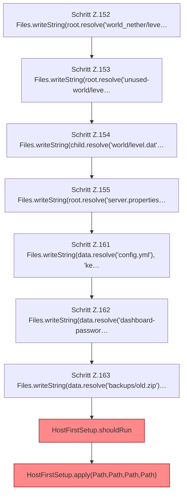

[[00 Start]] › [[Tests]] › [[HostMinimizeTest]] › [[HostMinimizeTest.Teil1]] › [[HostMinimizeTest.firstSetupClearsOnlyOuterWorldsAndCreatesTheVoidLobby]] › [[HostMinimizeTest.firstSetupClearsOnlyOuterWorldsAndCreatesTheVoidLobby.Teil2]]

# HostMinimizeTest.firstSetupClearsOnlyOuterWorldsAndCreatesTheVoidLobby.Teil2



```knoten
Schritt Z.152 Files.writeString(root.resolve('world_nether/leve…
  Zeile 152: schreibt Text in eine Datei. `Files.writeString(root.resolve('world_nether/leve…`
Schritt Z.153 Files.writeString(root.resolve('unused-world/leve…
  Zeile 153: schreibt Text in eine Datei. `Files.writeString(root.resolve('unused-world/leve…`
Schritt Z.154 Files.writeString(child.resolve('world/level.dat'…
  Zeile 154: schreibt Text in eine Datei. `Files.writeString(child.resolve('world/level.dat'…`
Schritt Z.155 Files.writeString(root.resolve('server.properties…
  Zeile 155: schreibt Text in eine Datei. `Files.writeString(root.resolve('server.properties…`
Schritt Z.161 Files.writeString(data.resolve('config.yml'), 'ke…
  Zeile 161: schreibt Text in eine Datei. `Files.writeString(data.resolve('config.yml'), 'ke…`
Schritt Z.162 Files.writeString(data.resolve('dashboard-passwor…
  Zeile 162: schreibt Text in eine Datei. `Files.writeString(data.resolve('dashboard-passwor…`
Schritt Z.163 Files.writeString(data.resolve('backups/old.zip')…
  Zeile 163: schreibt Text in eine Datei. `Files.writeString(data.resolve('backups/old.zip')…`
HostFirstSetup.shouldRun
  Die [[Glossar#Ersteinrichtung|Ersteinrichtung]] führt aus das. Entscheidet, ob `shouldRun`. Ruft `readState`, `writeMarker`. [[Glossar#Befund|Befund]]: [[Glossar#Altlast|Altlast]], wahrscheinlich. HostFirstSetup.java:35 akzeptiert pending; Schreibstelle nur HostMinimizeTest.java:216
HostFirstSetup.apply(Path,Path,Path,Path)
  Die [[Glossar#Ersteinrichtung|Ersteinrichtung]] wendet an das. Wendet an `apply`. Ruft `apply`. [[Glossar#Befund|Befund]]: toter Code, wahrscheinlich. src/main/java/de/aichele/childlauncher/HostFirstSetup.java:58–60 nur von Tests erreicht
```

> [!knoten]- Was die Blöcke tun
> - **Schritt Z.152 Files.writeString(root.resolve('world_nether/leve…**: Zeile 152: schreibt Text in eine Datei. `Files.writeString(root.resolve('world_nether/leve…`
> - **Schritt Z.153 Files.writeString(root.resolve('unused-world/leve…**: Zeile 153: schreibt Text in eine Datei. `Files.writeString(root.resolve('unused-world/leve…`
> - **Schritt Z.154 Files.writeString(child.resolve('world/level.dat'…**: Zeile 154: schreibt Text in eine Datei. `Files.writeString(child.resolve('world/level.dat'…`
> - **Schritt Z.155 Files.writeString(root.resolve('server.properties…**: Zeile 155: schreibt Text in eine Datei. `Files.writeString(root.resolve('server.properties…`
> - **Schritt Z.161 Files.writeString(data.resolve('config.yml'), 'ke…**: Zeile 161: schreibt Text in eine Datei. `Files.writeString(data.resolve('config.yml'), 'ke…`
> - **Schritt Z.162 Files.writeString(data.resolve('dashboard-passwor…**: Zeile 162: schreibt Text in eine Datei. `Files.writeString(data.resolve('dashboard-passwor…`
> - **Schritt Z.163 Files.writeString(data.resolve('backups/old.zip')…**: Zeile 163: schreibt Text in eine Datei. `Files.writeString(data.resolve('backups/old.zip')…`
> - **HostFirstSetup.shouldRun**: Die [[Glossar#Ersteinrichtung|Ersteinrichtung]] führt aus das. Entscheidet, ob `shouldRun`. Ruft `readState`, `writeMarker`. [[Glossar#Befund|Befund]]: [[Glossar#Altlast|Altlast]], wahrscheinlich. HostFirstSetup.java:35 akzeptiert pending; Schreibstelle nur HostMinimizeTest.java:216
> - **HostFirstSetup.apply(Path,Path,Path,Path)**: Die [[Glossar#Ersteinrichtung|Ersteinrichtung]] wendet an das. Wendet an `apply`. Ruft `apply`. [[Glossar#Befund|Befund]]: toter Code, wahrscheinlich. src/main/java/de/aichele/childlauncher/HostFirstSetup.java:58–60 nur von Tests erreicht

- Ein weiterer Abschnitt derselben Übersicht.
- Fortsetzung von `HostMinimizeTest.firstSetupClearsOnlyOuterWorldsAndCreatesTheVoidLobby`.
