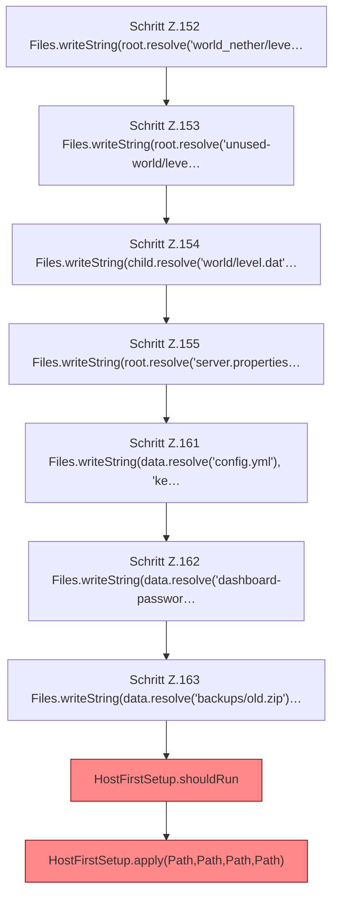

[[00 Start]] › [[Tests]] › [[HostMinimizeTest]] › [[HostMinimizeTest.Teil1]] › [[HostMinimizeTest.firstSetupClearsOnlyOuterWorldsAndCreatesTheVoidLobby]] › [[HostMinimizeTest.firstSetupClearsOnlyOuterWorldsAndCreatesTheVoidLobby.Teil2]]

# HostMinimizeTest.firstSetupClearsOnlyOuterWorldsAndCreatesTheVoidLobby.Teil2

- Fortsetzung von `HostMinimizeTest.firstSetupClearsOnlyOuterWorldsAndCreatesTheVoidLobby`, Quellreihenfolge.
