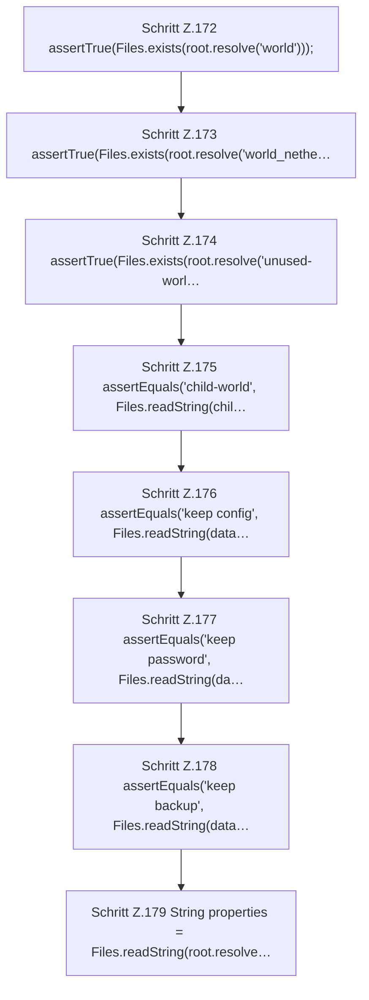

[[00 Start]] › [[Tests]] › [[HostMinimizeTest]] › [[HostMinimizeTest.Teil1]] › [[HostMinimizeTest.firstSetupClearsOnlyOuterWorldsAndCreatesTheVoidLobby]] › [[HostMinimizeTest.firstSetupClearsOnlyOuterWorldsAndCreatesTheVoidLobby.Teil3]]

# HostMinimizeTest.firstSetupClearsOnlyOuterWorldsAndCreatesTheVoidLobby.Teil3



```knoten
Schritt Z.172 assertTrue(Files.exists(root.resolve('world')));
  Zeile 172: Dateioperation. `assertTrue(Files.exists(root.resolve('world')));`
Schritt Z.173 assertTrue(Files.exists(root.resolve('world_nethe…
  Zeile 173: Dateioperation. `assertTrue(Files.exists(root.resolve('world_nethe…`
Schritt Z.174 assertTrue(Files.exists(root.resolve('unused-worl…
  Zeile 174: Dateioperation. `assertTrue(Files.exists(root.resolve('unused-worl…`
Schritt Z.175 assertEquals('child-world', Files.readString(chil…
  Zeile 175: liest Text aus einer Datei. `assertEquals('child-world', Files.readString(chil…`
Schritt Z.176 assertEquals('keep config', Files.readString(data…
  Zeile 176: liest Text aus einer Datei. `assertEquals('keep config', Files.readString(data…`
Schritt Z.177 assertEquals('keep password', Files.readString(da…
  Zeile 177: liest Text aus einer Datei. `assertEquals('keep password', Files.readString(da…`
Schritt Z.178 assertEquals('keep backup', Files.readString(data…
  Zeile 178: liest Text aus einer Datei. `assertEquals('keep backup', Files.readString(data…`
Schritt Z.179 String properties = Files.readString(root.resolve…
  Zeile 179: liest Text aus einer Datei. `String properties = Files.readString(root.resolve…`
```

> [!knoten]- Was die Blöcke tun
> - **Schritt Z.172 assertTrue(Files.exists(root.resolve('world')));**: Zeile 172: Dateioperation. `assertTrue(Files.exists(root.resolve('world')));`
> - **Schritt Z.173 assertTrue(Files.exists(root.resolve('world_nethe…**: Zeile 173: Dateioperation. `assertTrue(Files.exists(root.resolve('world_nethe…`
> - **Schritt Z.174 assertTrue(Files.exists(root.resolve('unused-worl…**: Zeile 174: Dateioperation. `assertTrue(Files.exists(root.resolve('unused-worl…`
> - **Schritt Z.175 assertEquals('child-world', Files.readString(chil…**: Zeile 175: liest Text aus einer Datei. `assertEquals('child-world', Files.readString(chil…`
> - **Schritt Z.176 assertEquals('keep config', Files.readString(data…**: Zeile 176: liest Text aus einer Datei. `assertEquals('keep config', Files.readString(data…`
> - **Schritt Z.177 assertEquals('keep password', Files.readString(da…**: Zeile 177: liest Text aus einer Datei. `assertEquals('keep password', Files.readString(da…`
> - **Schritt Z.178 assertEquals('keep backup', Files.readString(data…**: Zeile 178: liest Text aus einer Datei. `assertEquals('keep backup', Files.readString(data…`
> - **Schritt Z.179 String properties = Files.readString(root.resolve…**: Zeile 179: liest Text aus einer Datei. `String properties = Files.readString(root.resolve…`

- Ein weiterer Abschnitt derselben Übersicht.
- Fortsetzung von `HostMinimizeTest.firstSetupClearsOnlyOuterWorldsAndCreatesTheVoidLobby`.
