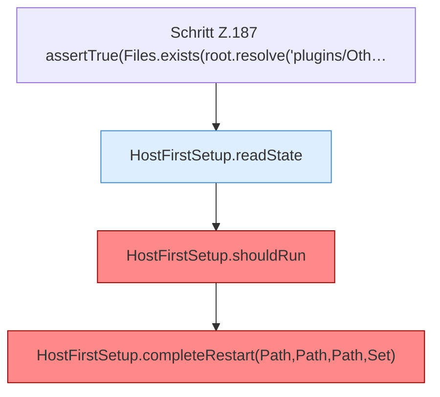

[[00 Start]] › [[Tests]] › [[HostMinimizeTest]] › [[HostMinimizeTest.Teil1]] › [[HostMinimizeTest.firstSetupClearsOnlyOuterWorldsAndCreatesTheVoidLobby]] › [[HostMinimizeTest.firstSetupClearsOnlyOuterWorldsAndCreatesTheVoidLobby.Teil4]]

# HostMinimizeTest.firstSetupClearsOnlyOuterWorldsAndCreatesTheVoidLobby.Teil4



```knoten
Schritt Z.187 assertTrue(Files.exists(root.resolve('plugins/Oth…
  Zeile 187: Dateioperation. `assertTrue(Files.exists(root.resolve('plugins/Oth…`
HostFirstSetup.readState
  Liest `readState`. Ruft `readState`.
HostFirstSetup.shouldRun
  Entscheidet, ob `shouldRun`. Ruft `readState`, `writeMarker`. Befund: Altlast (wahrscheinlich).
HostFirstSetup.completeRestart(Path,Path,Path,Set)
  Schließt ab `completeRestart`. Ruft `completeRestart`. Befund: toter Code (wahrscheinlich).
```

- Fortsetzung von `HostMinimizeTest.firstSetupClearsOnlyOuterWorldsAndCreatesTheVoidLobby`, Quellreihenfolge.
