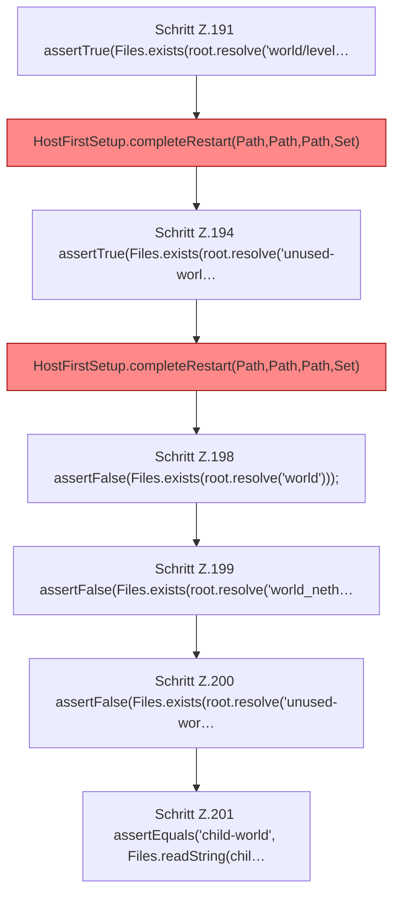

[[00 Start]] › [[Tests]] › [[HostMinimizeTest]] › [[HostMinimizeTest.Teil1]] › [[HostMinimizeTest.firstSetupClearsOnlyOuterWorldsAndCreatesTheVoidLobby]] › [[HostMinimizeTest.firstSetupClearsOnlyOuterWorldsAndCreatesTheVoidLobby.Teil5]]

# HostMinimizeTest.firstSetupClearsOnlyOuterWorldsAndCreatesTheVoidLobby.Teil5



```knoten
Schritt Z.191 assertTrue(Files.exists(root.resolve('world/level…
  Zeile 191: Dateioperation. `assertTrue(Files.exists(root.resolve('world/level…`
HostFirstSetup.completeRestart(Path,Path,Path,Set)
  Die [[Glossar#Ersteinrichtung|Ersteinrichtung]] kümmert sich um den [[Glossar#Neustart|Neustart]]. Schließt ab `completeRestart`. Ruft `completeRestart`. [[Glossar#Befund|Befund]]: toter Code, wahrscheinlich. src/main/java/de/aichele/childlauncher/HostFirstSetup.java:116–118 nur von Tests erreicht
Schritt Z.194 assertTrue(Files.exists(root.resolve('unused-worl…
  Zeile 194: Dateioperation. `assertTrue(Files.exists(root.resolve('unused-worl…`
Schritt Z.198 assertFalse(Files.exists(root.resolve('world')));
  Zeile 198: Dateioperation. `assertFalse(Files.exists(root.resolve('world')));`
Schritt Z.199 assertFalse(Files.exists(root.resolve('world_neth…
  Zeile 199: Dateioperation. `assertFalse(Files.exists(root.resolve('world_neth…`
Schritt Z.200 assertFalse(Files.exists(root.resolve('unused-wor…
  Zeile 200: Dateioperation. `assertFalse(Files.exists(root.resolve('unused-wor…`
Schritt Z.201 assertEquals('child-world', Files.readString(chil…
  Zeile 201: liest Text aus einer Datei. `assertEquals('child-world', Files.readString(chil…`
```

> [!knoten]- Was die Blöcke tun
> - **Schritt Z.191 assertTrue(Files.exists(root.resolve('world/level…**: Zeile 191: Dateioperation. `assertTrue(Files.exists(root.resolve('world/level…`
> - **HostFirstSetup.completeRestart(Path,Path,Path,Set)**: Die [[Glossar#Ersteinrichtung|Ersteinrichtung]] kümmert sich um den [[Glossar#Neustart|Neustart]]. Schließt ab `completeRestart`. Ruft `completeRestart`. [[Glossar#Befund|Befund]]: toter Code, wahrscheinlich. src/main/java/de/aichele/childlauncher/HostFirstSetup.java:116–118 nur von Tests erreicht
> - **Schritt Z.194 assertTrue(Files.exists(root.resolve('unused-worl…**: Zeile 194: Dateioperation. `assertTrue(Files.exists(root.resolve('unused-worl…`
> - **Schritt Z.198 assertFalse(Files.exists(root.resolve('world')));**: Zeile 198: Dateioperation. `assertFalse(Files.exists(root.resolve('world')));`
> - **Schritt Z.199 assertFalse(Files.exists(root.resolve('world_neth…**: Zeile 199: Dateioperation. `assertFalse(Files.exists(root.resolve('world_neth…`
> - **Schritt Z.200 assertFalse(Files.exists(root.resolve('unused-wor…**: Zeile 200: Dateioperation. `assertFalse(Files.exists(root.resolve('unused-wor…`
> - **Schritt Z.201 assertEquals('child-world', Files.readString(chil…**: Zeile 201: liest Text aus einer Datei. `assertEquals('child-world', Files.readString(chil…`

- Ein weiterer Abschnitt derselben Übersicht.
- Fortsetzung von `HostMinimizeTest.firstSetupClearsOnlyOuterWorldsAndCreatesTheVoidLobby`.
