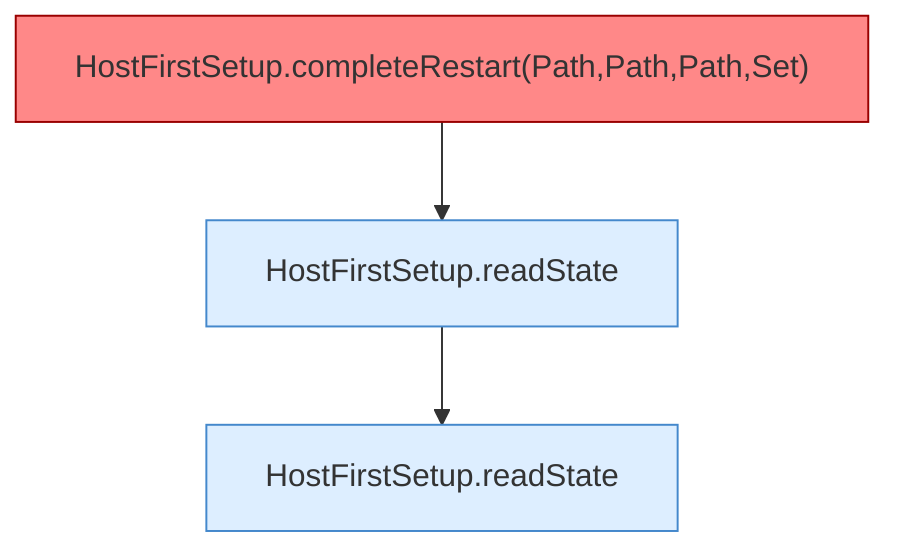

[[00 Start]] › [[Tests]] › [[HostMinimizeTest]] › [[HostMinimizeTest.Teil1]] › [[HostMinimizeTest.firstSetupClearsOnlyOuterWorldsAndCreatesTheVoidLobby]] › [[HostMinimizeTest.firstSetupClearsOnlyOuterWorldsAndCreatesTheVoidLobby.Teil6]]

# HostMinimizeTest.firstSetupClearsOnlyOuterWorldsAndCreatesTheVoidLobby.Teil6



```knoten
HostFirstSetup.completeRestart(Path,Path,Path,Set)
  Die [[Glossar#Ersteinrichtung|Ersteinrichtung]] kümmert sich um den [[Glossar#Neustart|Neustart]]. Schließt ab `completeRestart`. Ruft `completeRestart`. [[Glossar#Befund|Befund]]: toter Code, wahrscheinlich. src/main/java/de/aichele/childlauncher/HostFirstSetup.java:116–118 nur von Tests erreicht
HostFirstSetup.readState
  Die [[Glossar#Ersteinrichtung|Ersteinrichtung]] liest den Zustand. Liest `readState`. Ruft `readState`.
```

> [!knoten]- Was die Blöcke tun
> - **HostFirstSetup.completeRestart(Path,Path,Path,Set)**: Die [[Glossar#Ersteinrichtung|Ersteinrichtung]] kümmert sich um den [[Glossar#Neustart|Neustart]]. Schließt ab `completeRestart`. Ruft `completeRestart`. [[Glossar#Befund|Befund]]: toter Code, wahrscheinlich. src/main/java/de/aichele/childlauncher/HostFirstSetup.java:116–118 nur von Tests erreicht
> - **HostFirstSetup.readState**: Die [[Glossar#Ersteinrichtung|Ersteinrichtung]] liest den Zustand. Liest `readState`. Ruft `readState`.

- Ein weiterer Abschnitt derselben Übersicht.
- Fortsetzung von `HostMinimizeTest.firstSetupClearsOnlyOuterWorldsAndCreatesTheVoidLobby`.
