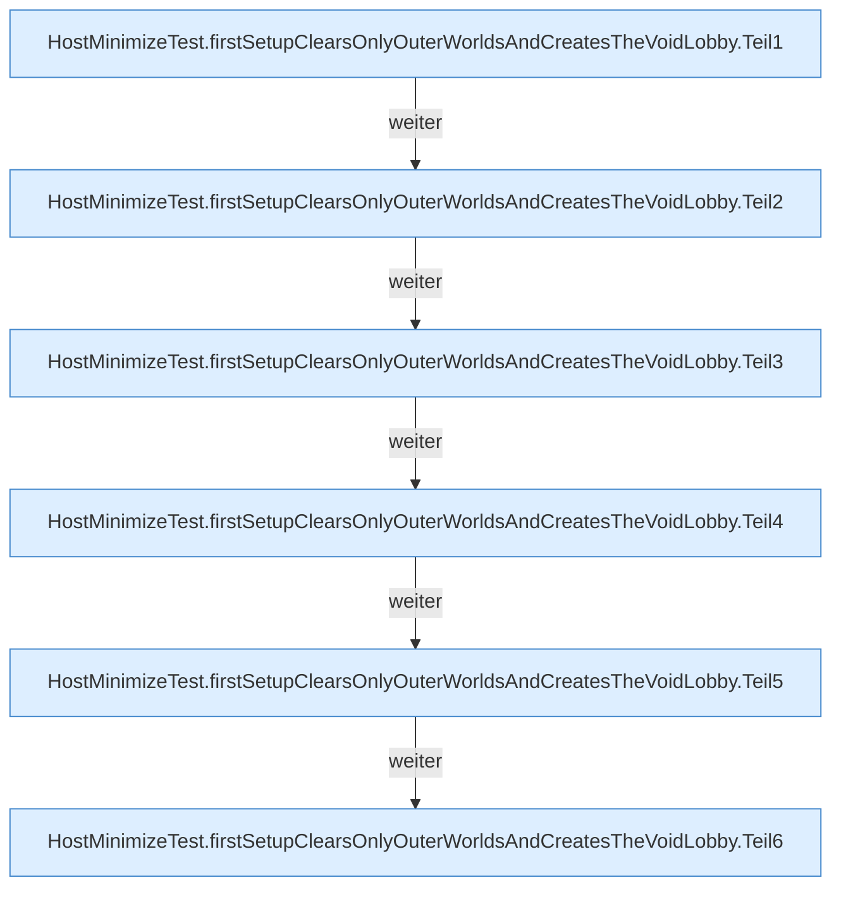

[[00 Start]] › [[Tests]] › [[HostMinimizeTest]] › [[HostMinimizeTest.Teil1]] › [[HostMinimizeTest.firstSetupClearsOnlyOuterWorldsAndCreatesTheVoidLobby]]

# HostMinimizeTest.firstSetupClearsOnlyOuterWorldsAndCreatesTheVoidLobby

`HostMinimizeTest.firstSetupClearsOnlyOuterWorldsAndCreatesTheVoidLobby()` [src/test/java/de/aichele/childlauncher/HostMinimizeTest.java:139–205](https://github.com/Sciddie/minecraft-serverhoster-plugin/blob/95b02b953b0b4c23673e900e021a7c3c844aa37d/src/test/java/de/aichele/childlauncher/HostMinimizeTest.java#L139-L205)

- `firstSetupClearsOnlyOuterWorldsAndCreatesTheVoidLobby` in `src/test/java/de/aichele/childlauncher/HostMinimizeTest.java`
- Auslöser: Test
