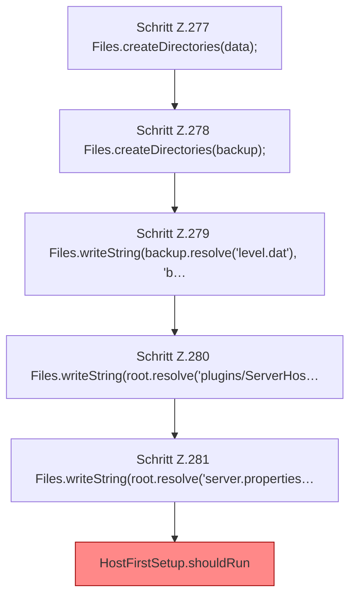

[[00 Start]] › [[Tests]] › [[HostMinimizeTest]] › [[HostMinimizeTest.Teil2]] › [[HostMinimizeTest.firstSetupProtectsConfiguredBackupWorldDirectories]] › [[HostMinimizeTest.firstSetupProtectsConfiguredBackupWorldDirectories.Teil1]]

# HostMinimizeTest.firstSetupProtectsConfiguredBackupWorldDirectories.Teil1



```knoten
Schritt Z.277 Files.createDirectories(data);
  Zeile 277: Dateioperation. `Files.createDirectories(data);`
Schritt Z.278 Files.createDirectories(backup);
  Zeile 278: Dateioperation. `Files.createDirectories(backup);`
Schritt Z.279 Files.writeString(backup.resolve('level.dat'), 'b…
  Zeile 279: schreibt Text in eine Datei. `Files.writeString(backup.resolve('level.dat'), 'b…`
Schritt Z.280 Files.writeString(root.resolve('plugins/ServerHos…
  Zeile 280: schreibt Text in eine Datei. `Files.writeString(root.resolve('plugins/ServerHos…`
Schritt Z.281 Files.writeString(root.resolve('server.properties…
  Zeile 281: schreibt Text in eine Datei. `Files.writeString(root.resolve('server.properties…`
HostFirstSetup.shouldRun
  Die [[Glossar#Ersteinrichtung|Ersteinrichtung]] führt aus das. Entscheidet, ob `shouldRun`. Ruft `readState`, `writeMarker`. [[Glossar#Befund|Befund]]: [[Glossar#Altlast|Altlast]], wahrscheinlich. HostFirstSetup.java:35 akzeptiert pending; Schreibstelle nur HostMinimizeTest.java:216
```

> [!knoten]- Was die Blöcke tun
> - **Schritt Z.277 Files.createDirectories(data);**: Zeile 277: Dateioperation. `Files.createDirectories(data);`
> - **Schritt Z.278 Files.createDirectories(backup);**: Zeile 278: Dateioperation. `Files.createDirectories(backup);`
> - **Schritt Z.279 Files.writeString(backup.resolve('level.dat'), 'b…**: Zeile 279: schreibt Text in eine Datei. `Files.writeString(backup.resolve('level.dat'), 'b…`
> - **Schritt Z.280 Files.writeString(root.resolve('plugins/ServerHos…**: Zeile 280: schreibt Text in eine Datei. `Files.writeString(root.resolve('plugins/ServerHos…`
> - **Schritt Z.281 Files.writeString(root.resolve('server.properties…**: Zeile 281: schreibt Text in eine Datei. `Files.writeString(root.resolve('server.properties…`
> - **HostFirstSetup.shouldRun**: Die [[Glossar#Ersteinrichtung|Ersteinrichtung]] führt aus das. Entscheidet, ob `shouldRun`. Ruft `readState`, `writeMarker`. [[Glossar#Befund|Befund]]: [[Glossar#Altlast|Altlast]], wahrscheinlich. HostFirstSetup.java:35 akzeptiert pending; Schreibstelle nur HostMinimizeTest.java:216

- Ein weiterer Abschnitt derselben Übersicht.
- Fortsetzung von `HostMinimizeTest.firstSetupProtectsConfiguredBackupWorldDirectories`.
