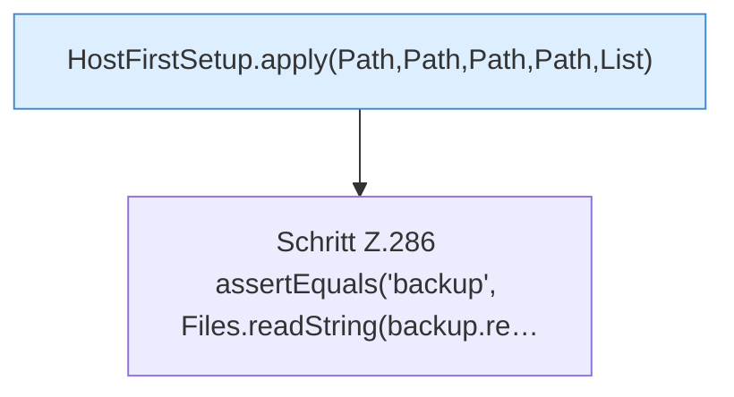

[[00 Start]] › [[Tests]] › [[HostMinimizeTest]] › [[HostMinimizeTest.Teil2]] › [[HostMinimizeTest.firstSetupProtectsConfiguredBackupWorldDirectories]] › [[HostMinimizeTest.firstSetupProtectsConfiguredBackupWorldDirectories.Teil2]]

# HostMinimizeTest.firstSetupProtectsConfiguredBackupWorldDirectories.Teil2



```knoten
HostFirstSetup.apply(Path,Path,Path,Path,List)
  Wendet an `apply`. Ruft `readState`, `requireRoot`, `otherPluginJars`.
Schritt Z.286 assertEquals('backup', Files.readString(backup.re…
  Zeile 286: liest Text aus einer Datei. `assertEquals('backup', Files.readString(backup.re…`
```

- Fortsetzung von `HostMinimizeTest.firstSetupProtectsConfiguredBackupWorldDirectories`, Quellreihenfolge.
