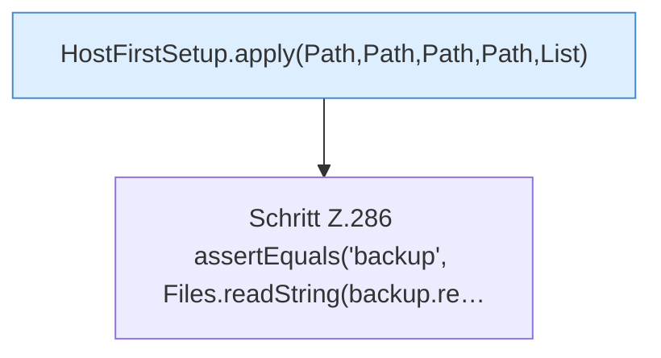

[[00 Start]] › [[Tests]] › [[HostMinimizeTest]] › [[HostMinimizeTest.Teil2]] › [[HostMinimizeTest.firstSetupProtectsConfiguredBackupWorldDirectories]] › [[HostMinimizeTest.firstSetupProtectsConfiguredBackupWorldDirectories.Teil2]]

# HostMinimizeTest.firstSetupProtectsConfiguredBackupWorldDirectories.Teil2

- Fortsetzung von `HostMinimizeTest.firstSetupProtectsConfiguredBackupWorldDirectories`, Quellreihenfolge.
