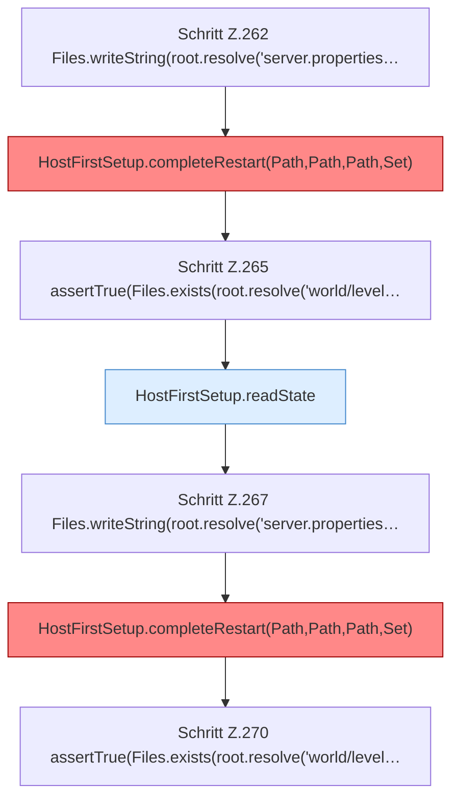

[[00 Start]] › [[Tests]] › [[HostMinimizeTest]] › [[HostMinimizeTest.Teil1]] › [[HostMinimizeTest.firstSetupRefusesCleanupWhenPreparedWorldSelectionWasChanged]] › [[HostMinimizeTest.firstSetupRefusesCleanupWhenPreparedWorldSelectionWasChanged.Teil2]]

# HostMinimizeTest.firstSetupRefusesCleanupWhenPreparedWorldSelectionWasChanged.Teil2



```knoten
Schritt Z.262 Files.writeString(root.resolve('server.properties…
  Zeile 262: schreibt Text in eine Datei. `Files.writeString(root.resolve('server.properties…`
HostFirstSetup.completeRestart(Path,Path,Path,Set)
  Die [[Glossar#Ersteinrichtung|Ersteinrichtung]] kümmert sich um den [[Glossar#Neustart|Neustart]]. Schließt ab `completeRestart`. Ruft `completeRestart`. [[Glossar#Befund|Befund]]: toter Code, wahrscheinlich. src/main/java/de/aichele/childlauncher/HostFirstSetup.java:116–118 nur von Tests erreicht
Schritt Z.265 assertTrue(Files.exists(root.resolve('world/level…
  Zeile 265: Dateioperation. `assertTrue(Files.exists(root.resolve('world/level…`
HostFirstSetup.readState
  Die [[Glossar#Ersteinrichtung|Ersteinrichtung]] liest den Zustand. Liest `readState`. Ruft `readState`.
Schritt Z.267 Files.writeString(root.resolve('server.properties…
  Zeile 267: schreibt Text in eine Datei. `Files.writeString(root.resolve('server.properties…`
Schritt Z.270 assertTrue(Files.exists(root.resolve('world/level…
  Zeile 270: Dateioperation. `assertTrue(Files.exists(root.resolve('world/level…`
```

> [!knoten]- Was die Blöcke tun
> - **Schritt Z.262 Files.writeString(root.resolve('server.properties…**: Zeile 262: schreibt Text in eine Datei. `Files.writeString(root.resolve('server.properties…`
> - **HostFirstSetup.completeRestart(Path,Path,Path,Set)**: Die [[Glossar#Ersteinrichtung|Ersteinrichtung]] kümmert sich um den [[Glossar#Neustart|Neustart]]. Schließt ab `completeRestart`. Ruft `completeRestart`. [[Glossar#Befund|Befund]]: toter Code, wahrscheinlich. src/main/java/de/aichele/childlauncher/HostFirstSetup.java:116–118 nur von Tests erreicht
> - **Schritt Z.265 assertTrue(Files.exists(root.resolve('world/level…**: Zeile 265: Dateioperation. `assertTrue(Files.exists(root.resolve('world/level…`
> - **HostFirstSetup.readState**: Die [[Glossar#Ersteinrichtung|Ersteinrichtung]] liest den Zustand. Liest `readState`. Ruft `readState`.
> - **Schritt Z.267 Files.writeString(root.resolve('server.properties…**: Zeile 267: schreibt Text in eine Datei. `Files.writeString(root.resolve('server.properties…`
> - **Schritt Z.270 assertTrue(Files.exists(root.resolve('world/level…**: Zeile 270: Dateioperation. `assertTrue(Files.exists(root.resolve('world/level…`

- Ein weiterer Abschnitt derselben Übersicht.
- Fortsetzung von `HostMinimizeTest.firstSetupRefusesCleanupWhenPreparedWorldSelectionWasChanged`.
