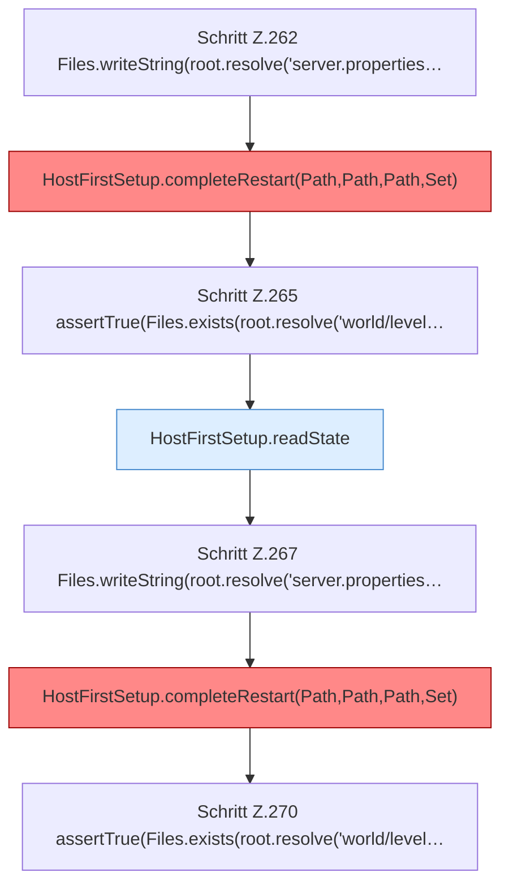

[[00 Start]] › [[Tests]] › [[HostMinimizeTest]] › [[HostMinimizeTest.Teil1]] › [[HostMinimizeTest.firstSetupRefusesCleanupWhenPreparedWorldSelectionWasChanged]] › [[HostMinimizeTest.firstSetupRefusesCleanupWhenPreparedWorldSelectionWasChanged.Teil2]]

# HostMinimizeTest.firstSetupRefusesCleanupWhenPreparedWorldSelectionWasChanged.Teil2



```knoten
Schritt Z.262 Files.writeString(root.resolve('server.properties…
  Zeile 262: schreibt Text in eine Datei. `Files.writeString(root.resolve('server.properties…`
HostFirstSetup.completeRestart(Path,Path,Path,Set)
  Schließt ab `completeRestart`. Ruft `completeRestart`. Befund: toter Code (wahrscheinlich).
Schritt Z.265 assertTrue(Files.exists(root.resolve('world/level…
  Zeile 265: Dateioperation. `assertTrue(Files.exists(root.resolve('world/level…`
HostFirstSetup.readState
  Liest `readState`. Ruft `readState`.
Schritt Z.267 Files.writeString(root.resolve('server.properties…
  Zeile 267: schreibt Text in eine Datei. `Files.writeString(root.resolve('server.properties…`
Schritt Z.270 assertTrue(Files.exists(root.resolve('world/level…
  Zeile 270: Dateioperation. `assertTrue(Files.exists(root.resolve('world/level…`
```

- Fortsetzung von `HostMinimizeTest.firstSetupRefusesCleanupWhenPreparedWorldSelectionWasChanged`, Quellreihenfolge.
