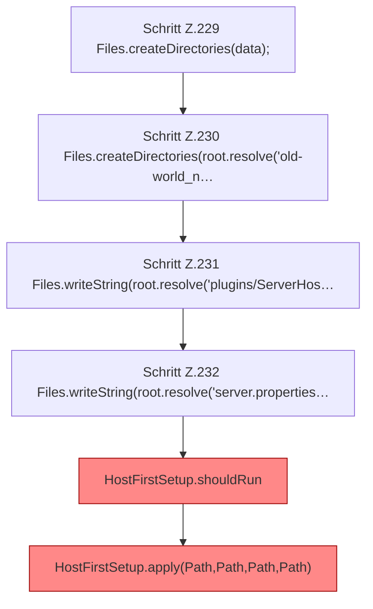

[[00 Start]] › [[Tests]] › [[HostMinimizeTest]] › [[HostMinimizeTest.Teil1]] › [[HostMinimizeTest.firstSetupResumesPreparationWithoutLosingOriginalWorldOrChangingLobby]] › [[HostMinimizeTest.firstSetupResumesPreparationWithoutLosingOriginalWorldOrChangingLobby.Teil1]]

# HostMinimizeTest.firstSetupResumesPreparationWithoutLosingOriginalWorldOrChangingLobby.Teil1

- Fortsetzung von `HostMinimizeTest.firstSetupResumesPreparationWithoutLosingOriginalWorldOrChangingLobby`, Quellreihenfolge.
