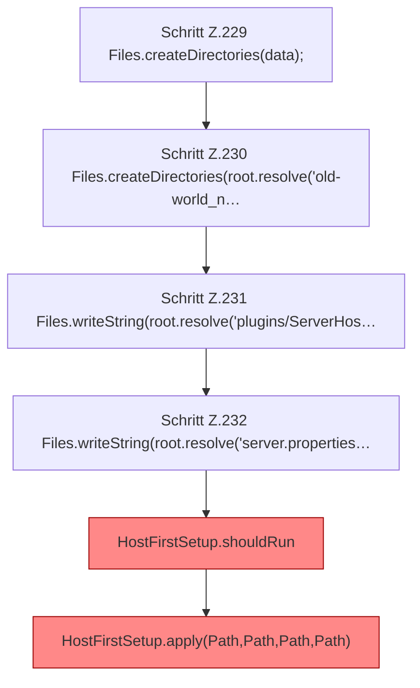

[[00 Start]] › [[Tests]] › [[HostMinimizeTest]] › [[HostMinimizeTest.Teil1]] › [[HostMinimizeTest.firstSetupResumesPreparationWithoutLosingOriginalWorldOrChangingLobby]] › [[HostMinimizeTest.firstSetupResumesPreparationWithoutLosingOriginalWorldOrChangingLobby.Teil1]]

# HostMinimizeTest.firstSetupResumesPreparationWithoutLosingOriginalWorldOrChangingLobby.Teil1



```knoten
Schritt Z.229 Files.createDirectories(data);
  Zeile 229: Dateioperation. `Files.createDirectories(data);`
Schritt Z.230 Files.createDirectories(root.resolve('old-world_n…
  Zeile 230: Dateioperation. `Files.createDirectories(root.resolve('old-world_n…`
Schritt Z.231 Files.writeString(root.resolve('plugins/ServerHos…
  Zeile 231: schreibt Text in eine Datei. `Files.writeString(root.resolve('plugins/ServerHos…`
Schritt Z.232 Files.writeString(root.resolve('server.properties…
  Zeile 232: schreibt Text in eine Datei. `Files.writeString(root.resolve('server.properties…`
HostFirstSetup.shouldRun
  Die [[Glossar#Ersteinrichtung|Ersteinrichtung]] führt aus das. Entscheidet, ob `shouldRun`. Ruft `readState`, `writeMarker`. [[Glossar#Befund|Befund]]: [[Glossar#Altlast|Altlast]], wahrscheinlich. HostFirstSetup.java:35 akzeptiert pending; Schreibstelle nur HostMinimizeTest.java:216
HostFirstSetup.apply(Path,Path,Path,Path)
  Die [[Glossar#Ersteinrichtung|Ersteinrichtung]] wendet an das. Wendet an `apply`. Ruft `apply`. [[Glossar#Befund|Befund]]: toter Code, wahrscheinlich. src/main/java/de/aichele/childlauncher/HostFirstSetup.java:58–60 nur von Tests erreicht
```

> [!knoten]- Was die Blöcke tun
> - **Schritt Z.229 Files.createDirectories(data);**: Zeile 229: Dateioperation. `Files.createDirectories(data);`
> - **Schritt Z.230 Files.createDirectories(root.resolve('old-world_n…**: Zeile 230: Dateioperation. `Files.createDirectories(root.resolve('old-world_n…`
> - **Schritt Z.231 Files.writeString(root.resolve('plugins/ServerHos…**: Zeile 231: schreibt Text in eine Datei. `Files.writeString(root.resolve('plugins/ServerHos…`
> - **Schritt Z.232 Files.writeString(root.resolve('server.properties…**: Zeile 232: schreibt Text in eine Datei. `Files.writeString(root.resolve('server.properties…`
> - **HostFirstSetup.shouldRun**: Die [[Glossar#Ersteinrichtung|Ersteinrichtung]] führt aus das. Entscheidet, ob `shouldRun`. Ruft `readState`, `writeMarker`. [[Glossar#Befund|Befund]]: [[Glossar#Altlast|Altlast]], wahrscheinlich. HostFirstSetup.java:35 akzeptiert pending; Schreibstelle nur HostMinimizeTest.java:216
> - **HostFirstSetup.apply(Path,Path,Path,Path)**: Die [[Glossar#Ersteinrichtung|Ersteinrichtung]] wendet an das. Wendet an `apply`. Ruft `apply`. [[Glossar#Befund|Befund]]: toter Code, wahrscheinlich. src/main/java/de/aichele/childlauncher/HostFirstSetup.java:58–60 nur von Tests erreicht

- Ein weiterer Abschnitt derselben Übersicht.
- Fortsetzung von `HostMinimizeTest.firstSetupResumesPreparationWithoutLosingOriginalWorldOrChangingLobby`.
