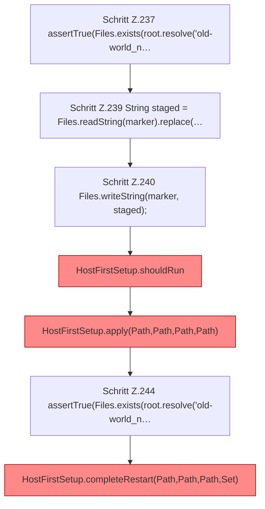

[[00 Start]] › [[Tests]] › [[HostMinimizeTest]] › [[HostMinimizeTest.Teil1]] › [[HostMinimizeTest.firstSetupResumesPreparationWithoutLosingOriginalWorldOrChangingLobby]] › [[HostMinimizeTest.firstSetupResumesPreparationWithoutLosingOriginalWorldOrChangingLobby.Teil2]]

# HostMinimizeTest.firstSetupResumesPreparationWithoutLosingOriginalWorldOrChangingLobby.Teil2

- Fortsetzung von `HostMinimizeTest.firstSetupResumesPreparationWithoutLosingOriginalWorldOrChangingLobby`, Quellreihenfolge.
