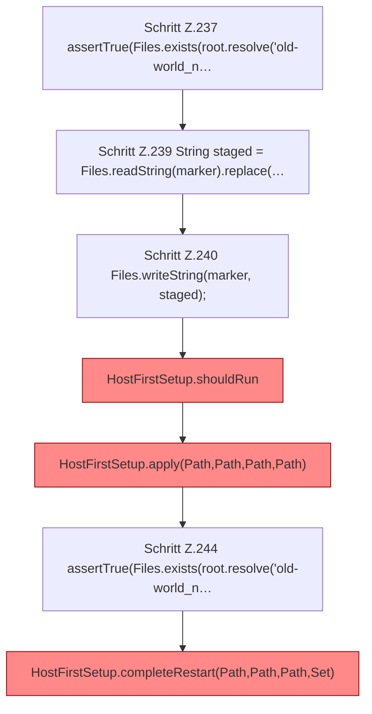

[[00 Start]] › [[Tests]] › [[HostMinimizeTest]] › [[HostMinimizeTest.Teil1]] › [[HostMinimizeTest.firstSetupResumesPreparationWithoutLosingOriginalWorldOrChangingLobby]] › [[HostMinimizeTest.firstSetupResumesPreparationWithoutLosingOriginalWorldOrChangingLobby.Teil2]]

# HostMinimizeTest.firstSetupResumesPreparationWithoutLosingOriginalWorldOrChangingLobby.Teil2



```knoten
Schritt Z.237 assertTrue(Files.exists(root.resolve('old-world_n…
  Zeile 237: Dateioperation. `assertTrue(Files.exists(root.resolve('old-world_n…`
Schritt Z.239 String staged = Files.readString(marker).replace(…
  Zeile 239: liest Text aus einer Datei. `String staged = Files.readString(marker).replace(…`
Schritt Z.240 Files.writeString(marker, staged);
  Zeile 240: schreibt Text in eine Datei. `Files.writeString(marker, staged);`
HostFirstSetup.shouldRun
  Die [[Glossar#Ersteinrichtung|Ersteinrichtung]] führt aus das. Entscheidet, ob `shouldRun`. Ruft `readState`, `writeMarker`. [[Glossar#Befund|Befund]]: [[Glossar#Altlast|Altlast]], wahrscheinlich. HostFirstSetup.java:35 akzeptiert pending; Schreibstelle nur HostMinimizeTest.java:216
HostFirstSetup.apply(Path,Path,Path,Path)
  Die [[Glossar#Ersteinrichtung|Ersteinrichtung]] wendet an das. Wendet an `apply`. Ruft `apply`. [[Glossar#Befund|Befund]]: toter Code, wahrscheinlich. src/main/java/de/aichele/childlauncher/HostFirstSetup.java:58–60 nur von Tests erreicht
Schritt Z.244 assertTrue(Files.exists(root.resolve('old-world_n…
  Zeile 244: Dateioperation. `assertTrue(Files.exists(root.resolve('old-world_n…`
HostFirstSetup.completeRestart(Path,Path,Path,Set)
  Die [[Glossar#Ersteinrichtung|Ersteinrichtung]] kümmert sich um den [[Glossar#Neustart|Neustart]]. Schließt ab `completeRestart`. Ruft `completeRestart`. [[Glossar#Befund|Befund]]: toter Code, wahrscheinlich. src/main/java/de/aichele/childlauncher/HostFirstSetup.java:116–118 nur von Tests erreicht
```

> [!knoten]- Was die Blöcke tun
> - **Schritt Z.237 assertTrue(Files.exists(root.resolve('old-world_n…**: Zeile 237: Dateioperation. `assertTrue(Files.exists(root.resolve('old-world_n…`
> - **Schritt Z.239 String staged = Files.readString(marker).replace(…**: Zeile 239: liest Text aus einer Datei. `String staged = Files.readString(marker).replace(…`
> - **Schritt Z.240 Files.writeString(marker, staged);**: Zeile 240: schreibt Text in eine Datei. `Files.writeString(marker, staged);`
> - **HostFirstSetup.shouldRun**: Die [[Glossar#Ersteinrichtung|Ersteinrichtung]] führt aus das. Entscheidet, ob `shouldRun`. Ruft `readState`, `writeMarker`. [[Glossar#Befund|Befund]]: [[Glossar#Altlast|Altlast]], wahrscheinlich. HostFirstSetup.java:35 akzeptiert pending; Schreibstelle nur HostMinimizeTest.java:216
> - **HostFirstSetup.apply(Path,Path,Path,Path)**: Die [[Glossar#Ersteinrichtung|Ersteinrichtung]] wendet an das. Wendet an `apply`. Ruft `apply`. [[Glossar#Befund|Befund]]: toter Code, wahrscheinlich. src/main/java/de/aichele/childlauncher/HostFirstSetup.java:58–60 nur von Tests erreicht
> - **Schritt Z.244 assertTrue(Files.exists(root.resolve('old-world_n…**: Zeile 244: Dateioperation. `assertTrue(Files.exists(root.resolve('old-world_n…`
> - **HostFirstSetup.completeRestart(Path,Path,Path,Set)**: Die [[Glossar#Ersteinrichtung|Ersteinrichtung]] kümmert sich um den [[Glossar#Neustart|Neustart]]. Schließt ab `completeRestart`. Ruft `completeRestart`. [[Glossar#Befund|Befund]]: toter Code, wahrscheinlich. src/main/java/de/aichele/childlauncher/HostFirstSetup.java:116–118 nur von Tests erreicht

- Ein weiterer Abschnitt derselben Übersicht.
- Fortsetzung von `HostMinimizeTest.firstSetupResumesPreparationWithoutLosingOriginalWorldOrChangingLobby`.
