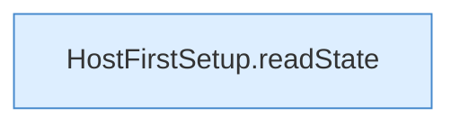

[[00 Start]] › [[Tests]] › [[HostMinimizeTest]] › [[HostMinimizeTest.Teil1]] › [[HostMinimizeTest.firstSetupResumesPreparationWithoutLosingOriginalWorldOrChangingLobby]] › [[HostMinimizeTest.firstSetupResumesPreparationWithoutLosingOriginalWorldOrChangingLobby.Teil3]]

# HostMinimizeTest.firstSetupResumesPreparationWithoutLosingOriginalWorldOrChangingLobby.Teil3



```knoten
HostFirstSetup.readState
  Die [[Glossar#Ersteinrichtung|Ersteinrichtung]] liest den Zustand. Liest `readState`. Ruft `readState`.
```

> [!knoten]- Was die Blöcke tun
> - **HostFirstSetup.readState**: Die [[Glossar#Ersteinrichtung|Ersteinrichtung]] liest den Zustand. Liest `readState`. Ruft `readState`.

- Ein weiterer Abschnitt derselben Übersicht.
- Fortsetzung von `HostMinimizeTest.firstSetupResumesPreparationWithoutLosingOriginalWorldOrChangingLobby`.
