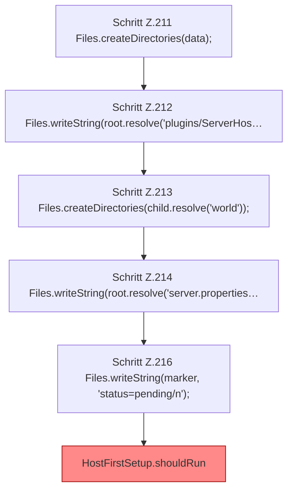

[[00 Start]] › [[Tests]] › [[HostMinimizeTest]] › [[HostMinimizeTest.Teil1]] › [[HostMinimizeTest.firstSetupRetriesPendingStateAndRejectsProtectedWorlds]] › [[HostMinimizeTest.firstSetupRetriesPendingStateAndRejectsProtectedWorlds.Teil1]]

# HostMinimizeTest.firstSetupRetriesPendingStateAndRejectsProtectedWorlds.Teil1

- Fortsetzung von `HostMinimizeTest.firstSetupRetriesPendingStateAndRejectsProtectedWorlds`, Quellreihenfolge.
