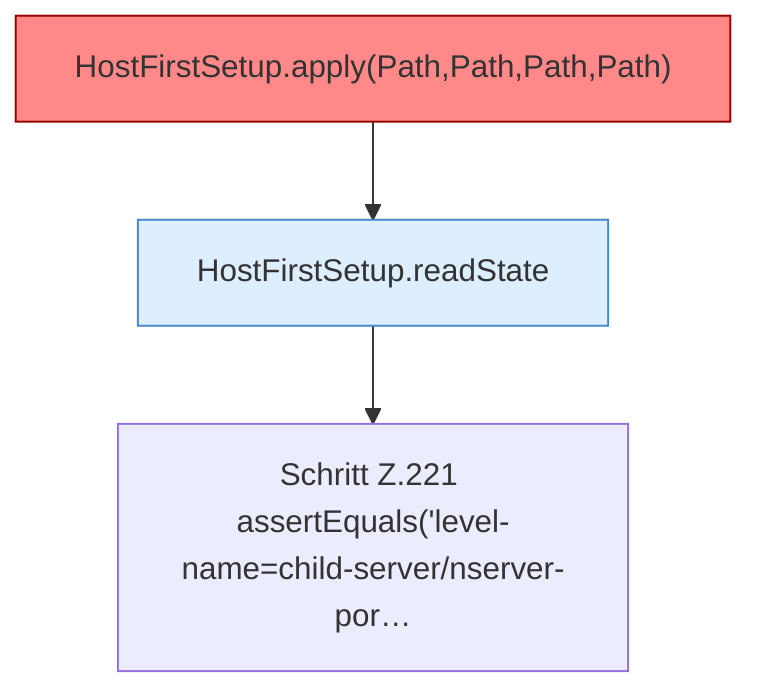

[[00 Start]] › [[Tests]] › [[HostMinimizeTest]] › [[HostMinimizeTest.Teil1]] › [[HostMinimizeTest.firstSetupRetriesPendingStateAndRejectsProtectedWorlds]] › [[HostMinimizeTest.firstSetupRetriesPendingStateAndRejectsProtectedWorlds.Teil2]]

# HostMinimizeTest.firstSetupRetriesPendingStateAndRejectsProtectedWorlds.Teil2



```knoten
HostFirstSetup.apply(Path,Path,Path,Path)
  Die [[Glossar#Ersteinrichtung|Ersteinrichtung]] wendet an das. Wendet an `apply`. Ruft `apply`. [[Glossar#Befund|Befund]]: toter Code, wahrscheinlich. src/main/java/de/aichele/childlauncher/HostFirstSetup.java:58–60 nur von Tests erreicht
HostFirstSetup.readState
  Die [[Glossar#Ersteinrichtung|Ersteinrichtung]] liest den Zustand. Liest `readState`. Ruft `readState`.
Schritt Z.221 assertEquals('level-name=child-server/nserver-por…
  Zeile 221: `assertEquals('level-name=child-server/nserver-por…`
```

> [!knoten]- Was die Blöcke tun
> - **HostFirstSetup.apply(Path,Path,Path,Path)**: Die [[Glossar#Ersteinrichtung|Ersteinrichtung]] wendet an das. Wendet an `apply`. Ruft `apply`. [[Glossar#Befund|Befund]]: toter Code, wahrscheinlich. src/main/java/de/aichele/childlauncher/HostFirstSetup.java:58–60 nur von Tests erreicht
> - **HostFirstSetup.readState**: Die [[Glossar#Ersteinrichtung|Ersteinrichtung]] liest den Zustand. Liest `readState`. Ruft `readState`.
> - **Schritt Z.221 assertEquals('level-name=child-server/nserver-por…**: Zeile 221: `assertEquals('level-name=child-server/nserver-por…`

- Ein weiterer Abschnitt derselben Übersicht.
- Fortsetzung von `HostMinimizeTest.firstSetupRetriesPendingStateAndRejectsProtectedWorlds`.
