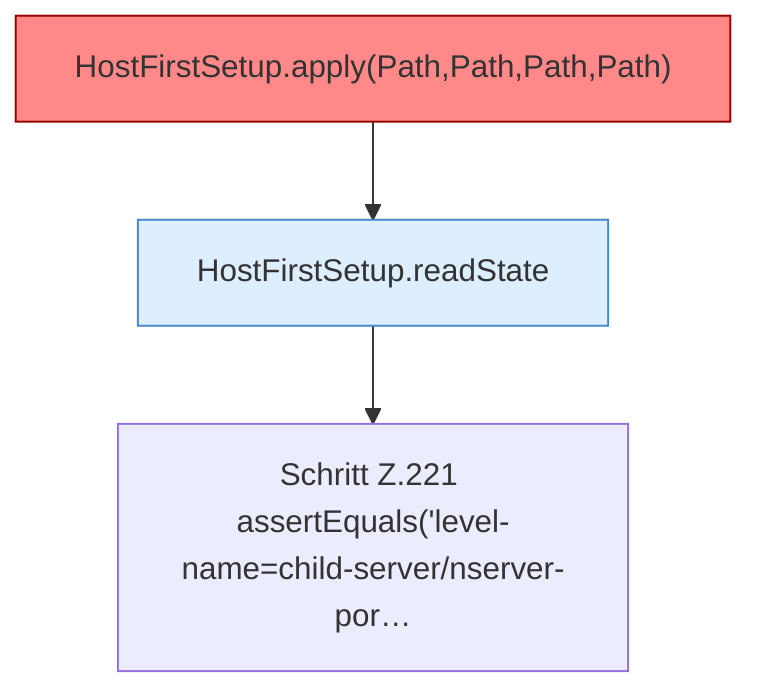

[[00 Start]] › [[Tests]] › [[HostMinimizeTest]] › [[HostMinimizeTest.Teil1]] › [[HostMinimizeTest.firstSetupRetriesPendingStateAndRejectsProtectedWorlds]] › [[HostMinimizeTest.firstSetupRetriesPendingStateAndRejectsProtectedWorlds.Teil2]]

# HostMinimizeTest.firstSetupRetriesPendingStateAndRejectsProtectedWorlds.Teil2

- Fortsetzung von `HostMinimizeTest.firstSetupRetriesPendingStateAndRejectsProtectedWorlds`, Quellreihenfolge.
