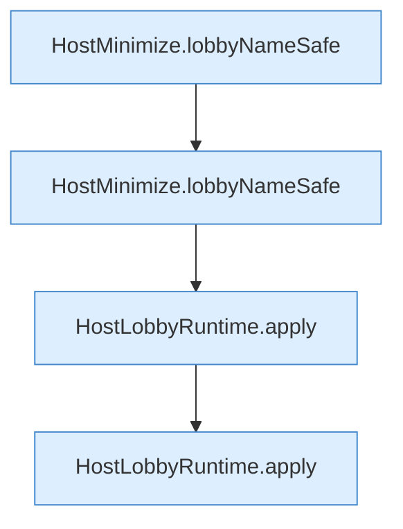

[[00 Start]] › [[Tests]] › [[HostMinimizeTest]] › [[HostMinimizeTest.Teil2]] › [[HostMinimizeTest.heapTuneNeverRequestsXmxAndLobbyRulesIgnoreOtherWorlds]] › [[HostMinimizeTest.heapTuneNeverRequestsXmxAndLobbyRulesIgnoreOtherWorlds.Teil1]]

# HostMinimizeTest.heapTuneNeverRequestsXmxAndLobbyRulesIgnoreOtherWorlds.Teil1

- Fortsetzung von `HostMinimizeTest.heapTuneNeverRequestsXmxAndLobbyRulesIgnoreOtherWorlds`, Quellreihenfolge.
