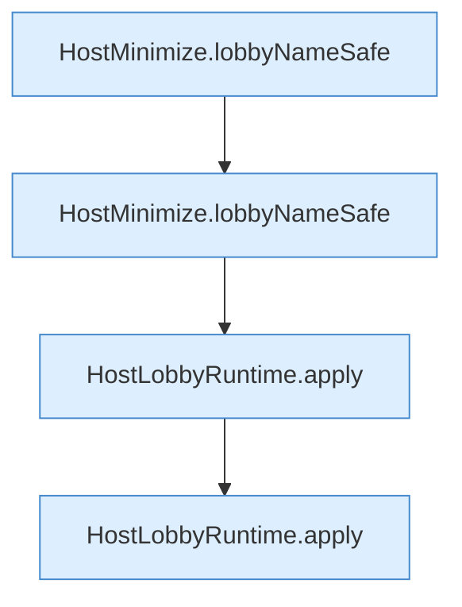

[[00 Start]] › [[Tests]] › [[HostMinimizeTest]] › [[HostMinimizeTest.Teil2]] › [[HostMinimizeTest.heapTuneNeverRequestsXmxAndLobbyRulesIgnoreOtherWorlds]] › [[HostMinimizeTest.heapTuneNeverRequestsXmxAndLobbyRulesIgnoreOtherWorlds.Teil1]]

# HostMinimizeTest.heapTuneNeverRequestsXmxAndLobbyRulesIgnoreOtherWorlds.Teil1



```knoten
HostMinimize.lobbyNameSafe
  Das Verkleinern des [[Glossar#Host|Host]] kümmert sich um den Namen die erlaubte Grenze. `lobbyNameSafe` in `HostMinimize.java`.
HostLobbyRuntime.apply
  Dieser Teil wendet an das. Wendet an `apply`. Ruft `worldNameSafe`.
```

> [!knoten]- Was die Blöcke tun
> - **HostMinimize.lobbyNameSafe**: Das Verkleinern des [[Glossar#Host|Host]] kümmert sich um den Namen die erlaubte Grenze. `lobbyNameSafe` in `HostMinimize.java`.
> - **HostLobbyRuntime.apply**: Dieser Teil wendet an das. Wendet an `apply`. Ruft `worldNameSafe`.

- Ein weiterer Abschnitt derselben Übersicht.
- Fortsetzung von `HostMinimizeTest.heapTuneNeverRequestsXmxAndLobbyRulesIgnoreOtherWorlds`.
