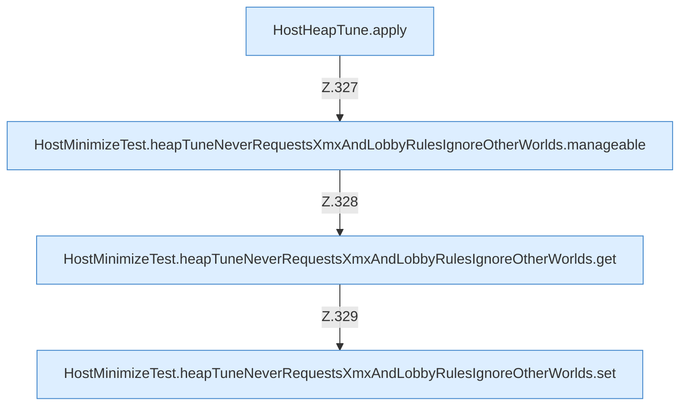

[[00 Start]] › [[Tests]] › [[HostMinimizeTest]] › [[HostMinimizeTest.Teil2]] › [[HostMinimizeTest.heapTuneNeverRequestsXmxAndLobbyRulesIgnoreOtherWorlds]] › [[HostMinimizeTest.heapTuneNeverRequestsXmxAndLobbyRulesIgnoreOtherWorlds.Teil2]]

# HostMinimizeTest.heapTuneNeverRequestsXmxAndLobbyRulesIgnoreOtherWorlds.Teil2



```knoten
HostHeapTune.apply
  Dieser Teil wendet an das. Wendet an `apply`.
HostMinimizeTest.heapTuneNeverRequestsXmxAndLobbyRulesIgnoreOtherWorlds.manageable
  Ein Schritt in einem [[Glossar#Probelauf|Probelauf]]. Er gehört nicht zum laufenden Server. `manageable` in `HostMinimizeTest.java`. Nur Test.
HostMinimizeTest.heapTuneNeverRequestsXmxAndLobbyRulesIgnoreOtherWorlds.get
  Ein Schritt in einem [[Glossar#Probelauf|Probelauf]]. Er gehört nicht zum laufenden Server. Liefert `get`. Nur Test.
HostMinimizeTest.heapTuneNeverRequestsXmxAndLobbyRulesIgnoreOtherWorlds.set
  Ein Schritt in einem [[Glossar#Probelauf|Probelauf]]. Er gehört nicht zum laufenden Server. Setzt `set`. Nur Test.
```

> [!knoten]- Was die Blöcke tun
> - **HostHeapTune.apply**: Dieser Teil wendet an das. Wendet an `apply`.
> - **HostMinimizeTest.heapTuneNeverRequestsXmxAndLobbyRulesIgnoreOtherWorlds.manageable**: Ein Schritt in einem [[Glossar#Probelauf|Probelauf]]. Er gehört nicht zum laufenden Server. `manageable` in `HostMinimizeTest.java`. Nur Test.
> - **HostMinimizeTest.heapTuneNeverRequestsXmxAndLobbyRulesIgnoreOtherWorlds.get**: Ein Schritt in einem [[Glossar#Probelauf|Probelauf]]. Er gehört nicht zum laufenden Server. Liefert `get`. Nur Test.
> - **HostMinimizeTest.heapTuneNeverRequestsXmxAndLobbyRulesIgnoreOtherWorlds.set**: Ein Schritt in einem [[Glossar#Probelauf|Probelauf]]. Er gehört nicht zum laufenden Server. Setzt `set`. Nur Test.

- Ein weiterer Abschnitt derselben Übersicht.
- Fortsetzung von `HostMinimizeTest.heapTuneNeverRequestsXmxAndLobbyRulesIgnoreOtherWorlds`.
