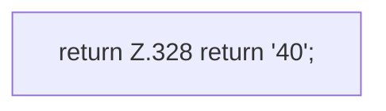

[[00 Start]] › [[Tests]] › [[HostMinimizeTest]] › [[HostMinimizeTest.Teil2]] › [[HostMinimizeTest.heapTuneNeverRequestsXmxAndLobbyRulesIgnoreOtherWorlds]] › [[HostMinimizeTest.heapTuneNeverRequestsXmxAndLobbyRulesIgnoreOtherWorlds.get]]

# HostMinimizeTest.heapTuneNeverRequestsXmxAndLobbyRulesIgnoreOtherWorlds.get

`HostMinimizeTest.get(String name)` [src/test/java/de/aichele/childlauncher/HostMinimizeTest.java:328–328](https://github.com/Sciddie/minecraft-serverhoster-plugin/blob/95b02b953b0b4c23673e900e021a7c3c844aa37d/src/test/java/de/aichele/childlauncher/HostMinimizeTest.java#L328-L328)



```knoten
return Z.328 return '40';
  Zeile 328: Rückgabe `return '40';`.
```

> [!knoten]- Was die Blöcke tun
> - **return Z.328 return '40';**: Zeile 328: Rückgabe `return '40';`.

- Ein Schritt in einem [[Glossar#Probelauf|Probelauf]]. Er gehört nicht zum laufenden Server.
- `get` in `src/test/java/de/aichele/childlauncher/HostMinimizeTest.java`
- Das ist ein Probelauf, kein Teil des laufenden Servers.
