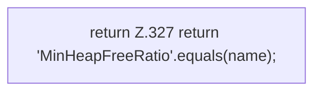

[[00 Start]] › [[Tests]] › [[HostMinimizeTest]] › [[HostMinimizeTest.Teil2]] › [[HostMinimizeTest.heapTuneNeverRequestsXmxAndLobbyRulesIgnoreOtherWorlds]] › [[HostMinimizeTest.heapTuneNeverRequestsXmxAndLobbyRulesIgnoreOtherWorlds.manageable]]

# HostMinimizeTest.heapTuneNeverRequestsXmxAndLobbyRulesIgnoreOtherWorlds.manageable

`HostMinimizeTest.manageable(String name)` [src/test/java/de/aichele/childlauncher/HostMinimizeTest.java:327–327](https://github.com/Sciddie/minecraft-serverhoster-plugin/blob/95b02b953b0b4c23673e900e021a7c3c844aa37d/src/test/java/de/aichele/childlauncher/HostMinimizeTest.java#L327-L327)



```knoten
return Z.327 return 'MinHeapFreeRatio'.equals(name);
  Zeile 327: Rückgabe `return 'MinHeapFreeRatio'.equals(name);`.
```

> [!knoten]- Was die Blöcke tun
> - **return Z.327 return 'MinHeapFreeRatio'.equals(name);**: Zeile 327: Rückgabe `return 'MinHeapFreeRatio'.equals(name);`.

- Ein Schritt in einem [[Glossar#Probelauf|Probelauf]]. Er gehört nicht zum laufenden Server.
- `manageable` in `src/test/java/de/aichele/childlauncher/HostMinimizeTest.java`
- Das ist ein Probelauf, kein Teil des laufenden Servers.
