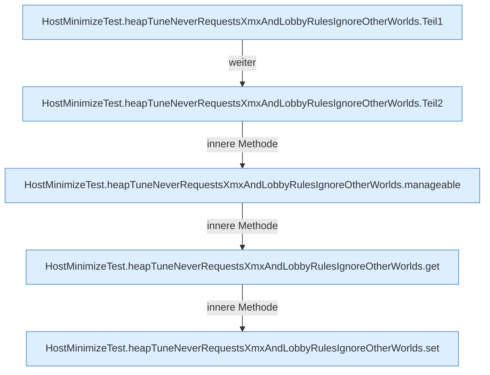

[[00 Start]] › [[Tests]] › [[HostMinimizeTest]] › [[HostMinimizeTest.Teil2]] › [[HostMinimizeTest.heapTuneNeverRequestsXmxAndLobbyRulesIgnoreOtherWorlds]]

# HostMinimizeTest.heapTuneNeverRequestsXmxAndLobbyRulesIgnoreOtherWorlds

`HostMinimizeTest.heapTuneNeverRequestsXmxAndLobbyRulesIgnoreOtherWorlds()` [src/test/java/de/aichele/childlauncher/HostMinimizeTest.java:316–334](https://github.com/Sciddie/minecraft-serverhoster-plugin/blob/95b02b953b0b4c23673e900e021a7c3c844aa37d/src/test/java/de/aichele/childlauncher/HostMinimizeTest.java#L316-L334)



```knoten
HostMinimizeTest.heapTuneNeverRequestsXmxAndLobbyRulesIgnoreOtherWorlds.Teil1
  Abschnitt 1 dieses Ablaufs, in Quellreihenfolge.
HostMinimizeTest.heapTuneNeverRequestsXmxAndLobbyRulesIgnoreOtherWorlds.Teil2
  Abschnitt 2 dieses Ablaufs, in Quellreihenfolge.
HostMinimizeTest.heapTuneNeverRequestsXmxAndLobbyRulesIgnoreOtherWorlds.manageable
  `manageable` in `HostMinimizeTest.java`. Nur Test.
HostMinimizeTest.heapTuneNeverRequestsXmxAndLobbyRulesIgnoreOtherWorlds.get
  Liefert `get`. Nur Test.
HostMinimizeTest.heapTuneNeverRequestsXmxAndLobbyRulesIgnoreOtherWorlds.set
  Setzt `set`. Nur Test.
```

- `heapTuneNeverRequestsXmxAndLobbyRulesIgnoreOtherWorlds` in `src/test/java/de/aichele/childlauncher/HostMinimizeTest.java`
- Auslöser: Test
