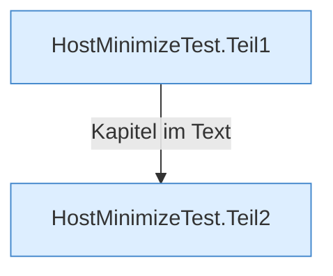

[[00 Start]] › [[Tests]] › [[HostMinimizeTest]]

# HostMinimizeTest



```knoten
HostMinimizeTest.Teil1
  Ein weiterer Abschnitt derselben Übersicht.
HostMinimizeTest.Teil2
  Ein weiterer Abschnitt derselben Übersicht.
```

> [!knoten] Was die Blöcke tun
> - **HostMinimizeTest.Teil1**: Ein weiterer Abschnitt derselben Übersicht.
> - **HostMinimizeTest.Teil2**: Ein weiterer Abschnitt derselben Übersicht.

- [[Glossar#Probelauf|Probelauf]] für das Verkleinern des [[Glossar#Host|Host]]. Er schreibt auch die Merkdatei der [[Glossar#Ersteinrichtung|Ersteinrichtung]].
