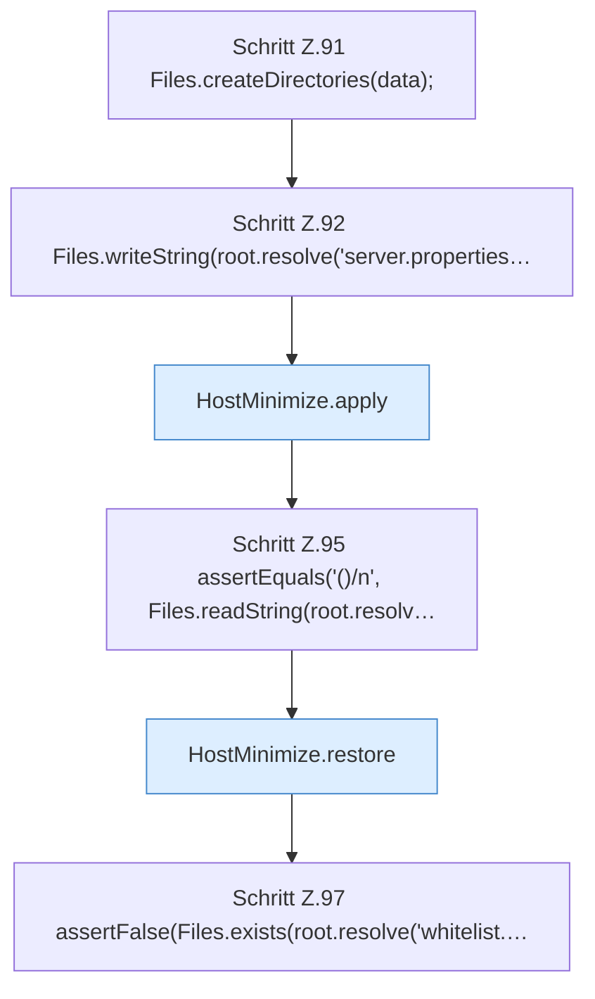

[[00 Start]] › [[Tests]] › [[HostMinimizeTest]] › [[HostMinimizeTest.Teil1]] › [[HostMinimizeTest.missingWhitelistIsRemovedAgainOnRollback]]

# HostMinimizeTest.missingWhitelistIsRemovedAgainOnRollback

`HostMinimizeTest.missingWhitelistIsRemovedAgainOnRollback()` [src/test/java/de/aichele/childlauncher/HostMinimizeTest.java:88–98](https://github.com/Sciddie/minecraft-serverhoster-plugin/blob/95b02b953b0b4c23673e900e021a7c3c844aa37d/src/test/java/de/aichele/childlauncher/HostMinimizeTest.java#L88-L98)



```knoten
Schritt Z.91 Files.createDirectories(data);
  Zeile 91: Dateioperation. `Files.createDirectories(data);`
Schritt Z.92 Files.writeString(root.resolve('server.properties…
  Zeile 92: schreibt Text in eine Datei. `Files.writeString(root.resolve('server.properties…`
HostMinimize.apply
  Das Verkleinern des [[Glossar#Host|Host]] wendet an das. Wendet an `apply`. Ruft `assertRoot`, `assertEditable`, `update`.
Schritt Z.95 assertEquals('()/n', Files.readString(root.resolv…
  Zeile 95: liest Text aus einer Datei. `assertEquals('()/n', Files.readString(root.resolv…`
HostMinimize.restore
  Das Verkleinern des [[Glossar#Host|Host]] stellt wieder her das. Stellt wieder her `restore`. Ruft `assertEditable`.
Schritt Z.97 assertFalse(Files.exists(root.resolve('whitelist.…
  Zeile 97: Dateioperation. `assertFalse(Files.exists(root.resolve('whitelist.…`
```

> [!knoten]- Was die Blöcke tun
> - **Schritt Z.91 Files.createDirectories(data);**: Zeile 91: Dateioperation. `Files.createDirectories(data);`
> - **Schritt Z.92 Files.writeString(root.resolve('server.properties…**: Zeile 92: schreibt Text in eine Datei. `Files.writeString(root.resolve('server.properties…`
> - **HostMinimize.apply**: Das Verkleinern des [[Glossar#Host|Host]] wendet an das. Wendet an `apply`. Ruft `assertRoot`, `assertEditable`, `update`.
> - **Schritt Z.95 assertEquals('()/n', Files.readString(root.resolv…**: Zeile 95: liest Text aus einer Datei. `assertEquals('()/n', Files.readString(root.resolv…`
> - **HostMinimize.restore**: Das Verkleinern des [[Glossar#Host|Host]] stellt wieder her das. Stellt wieder her `restore`. Ruft `assertEditable`.
> - **Schritt Z.97 assertFalse(Files.exists(root.resolve('whitelist.…**: Zeile 97: Dateioperation. `assertFalse(Files.exists(root.resolve('whitelist.…`

- Ein Schritt in einem [[Glossar#Probelauf|Probelauf]]. Er gehört nicht zum laufenden Server.
- `missingWhitelistIsRemovedAgainOnRollback` in `src/test/java/de/aichele/childlauncher/HostMinimizeTest.java`
- Das ist ein Probelauf, kein Teil des laufenden Servers.
