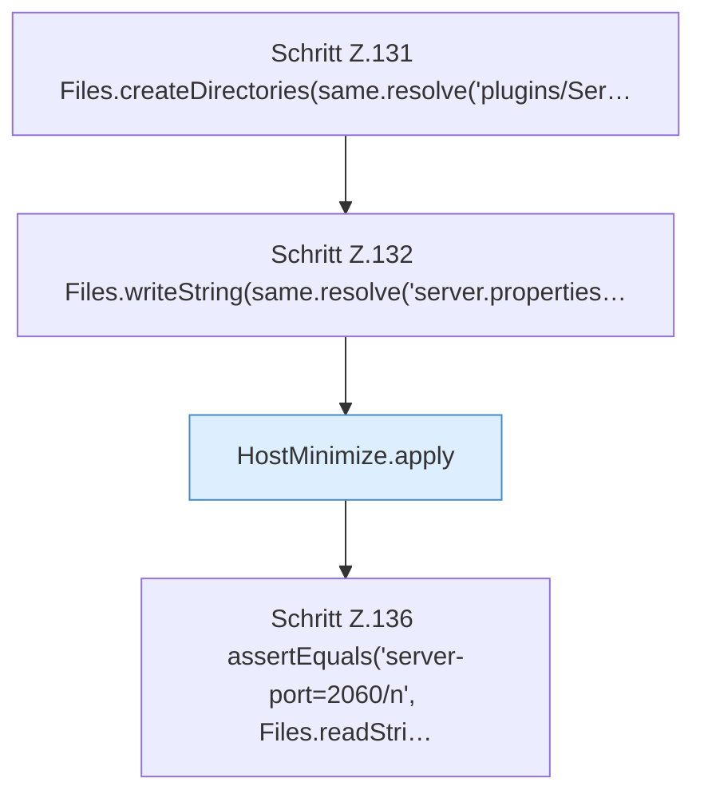

[[00 Start]] › [[Tests]] › [[HostMinimizeTest]] › [[HostMinimizeTest.Teil1]] › [[HostMinimizeTest.symlinkAndChildRootAreRefused]] › [[HostMinimizeTest.symlinkAndChildRootAreRefused.Teil2]]

# HostMinimizeTest.symlinkAndChildRootAreRefused.Teil2

- Fortsetzung von `HostMinimizeTest.symlinkAndChildRootAreRefused`, Quellreihenfolge.
