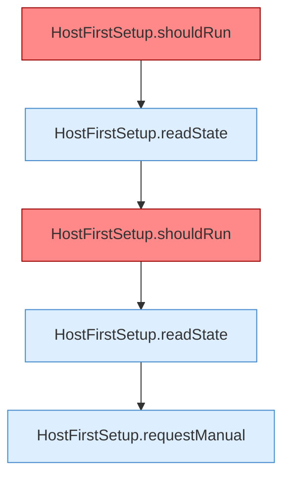

[[00 Start]] › [[Tests]] › [[HostMinimizeTest]] › [[HostMinimizeTest.Teil2]] › [[HostMinimizeTest.upgradesRequireManualConfirmationButFreshInstallsRunAutomatically]] › [[HostMinimizeTest.upgradesRequireManualConfirmationButFreshInstallsRunAutomatically.Teil1]]

# HostMinimizeTest.upgradesRequireManualConfirmationButFreshInstallsRunAutomatically.Teil1



```knoten
HostFirstSetup.shouldRun
  Die [[Glossar#Ersteinrichtung|Ersteinrichtung]] führt aus das. Entscheidet, ob `shouldRun`. Ruft `readState`, `writeMarker`. [[Glossar#Befund|Befund]]: [[Glossar#Altlast|Altlast]], wahrscheinlich. HostFirstSetup.java:35 akzeptiert pending; Schreibstelle nur HostMinimizeTest.java:216
HostFirstSetup.readState
  Die [[Glossar#Ersteinrichtung|Ersteinrichtung]] liest den Zustand. Liest `readState`. Ruft `readState`.
HostFirstSetup.requestManual
  Die [[Glossar#Ersteinrichtung|Ersteinrichtung]] fordert an die Handarbeit. Fordert an `requestManual`. Ruft `readState`, `writeMarker`.
```

> [!knoten]- Was die Blöcke tun
> - **HostFirstSetup.shouldRun**: Die [[Glossar#Ersteinrichtung|Ersteinrichtung]] führt aus das. Entscheidet, ob `shouldRun`. Ruft `readState`, `writeMarker`. [[Glossar#Befund|Befund]]: [[Glossar#Altlast|Altlast]], wahrscheinlich. HostFirstSetup.java:35 akzeptiert pending; Schreibstelle nur HostMinimizeTest.java:216
> - **HostFirstSetup.readState**: Die [[Glossar#Ersteinrichtung|Ersteinrichtung]] liest den Zustand. Liest `readState`. Ruft `readState`.
> - **HostFirstSetup.requestManual**: Die [[Glossar#Ersteinrichtung|Ersteinrichtung]] fordert an die Handarbeit. Fordert an `requestManual`. Ruft `readState`, `writeMarker`.

- Ein weiterer Abschnitt derselben Übersicht.
- Fortsetzung von `HostMinimizeTest.upgradesRequireManualConfirmationButFreshInstallsRunAutomatically`.
