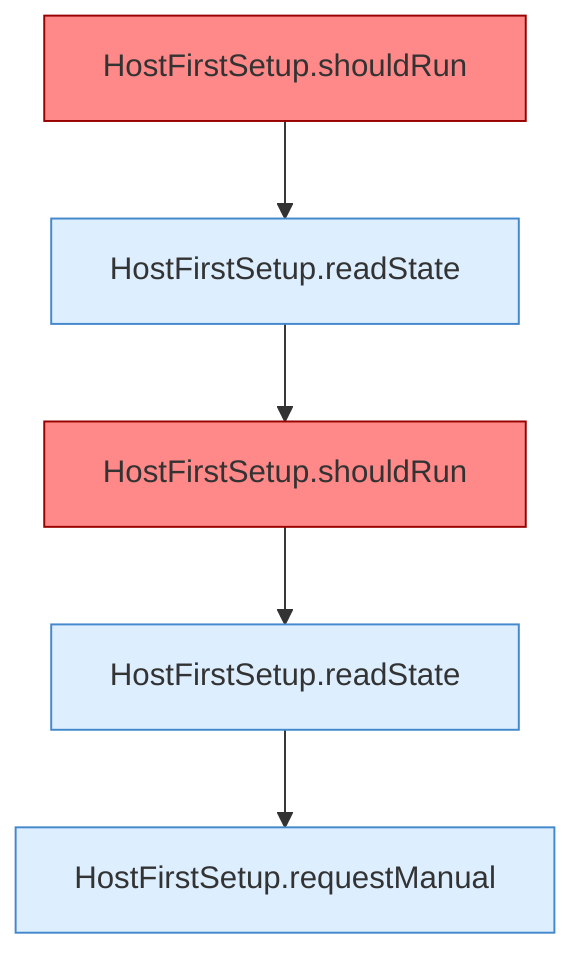

[[00 Start]] › [[Tests]] › [[HostMinimizeTest]] › [[HostMinimizeTest.Teil2]] › [[HostMinimizeTest.upgradesRequireManualConfirmationButFreshInstallsRunAutomatically]] › [[HostMinimizeTest.upgradesRequireManualConfirmationButFreshInstallsRunAutomatically.Teil1]]

# HostMinimizeTest.upgradesRequireManualConfirmationButFreshInstallsRunAutomatically.Teil1



```knoten
HostFirstSetup.shouldRun
  Entscheidet, ob `shouldRun`. Ruft `readState`, `writeMarker`. Befund: Altlast (wahrscheinlich).
HostFirstSetup.readState
  Liest `readState`. Ruft `readState`.
HostFirstSetup.requestManual
  Fordert an `requestManual`. Ruft `readState`, `writeMarker`.
```

- Fortsetzung von `HostMinimizeTest.upgradesRequireManualConfirmationButFreshInstallsRunAutomatically`, Quellreihenfolge.
