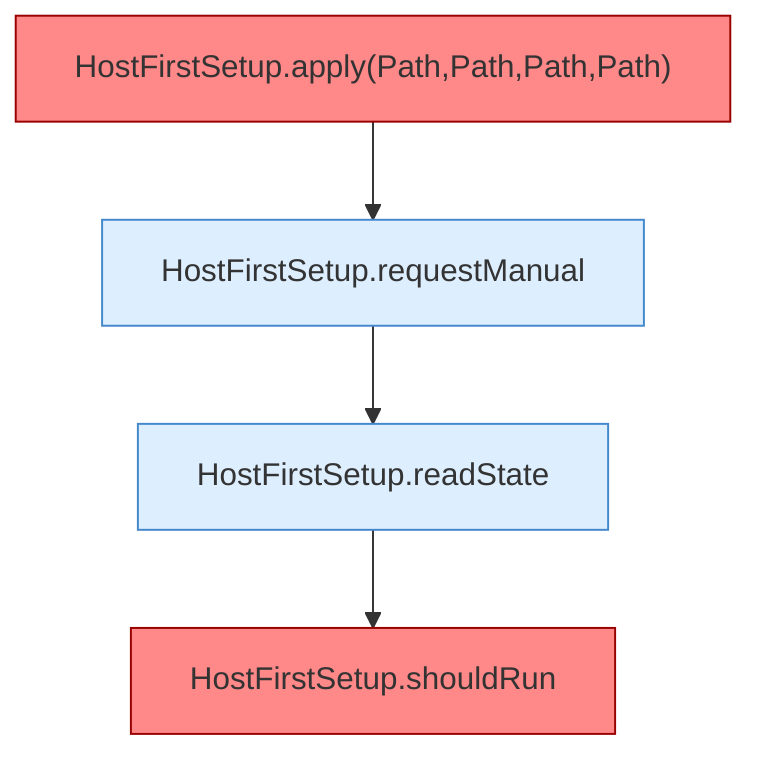

[[00 Start]] › [[Tests]] › [[HostMinimizeTest]] › [[HostMinimizeTest.Teil2]] › [[HostMinimizeTest.upgradesRequireManualConfirmationButFreshInstallsRunAutomatically]] › [[HostMinimizeTest.upgradesRequireManualConfirmationButFreshInstallsRunAutomatically.Teil2]]

# HostMinimizeTest.upgradesRequireManualConfirmationButFreshInstallsRunAutomatically.Teil2

- Fortsetzung von `HostMinimizeTest.upgradesRequireManualConfirmationButFreshInstallsRunAutomatically`, Quellreihenfolge.
