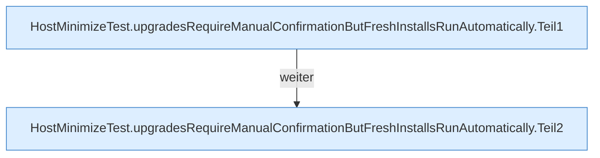

[[00 Start]] › [[Tests]] › [[HostMinimizeTest]] › [[HostMinimizeTest.Teil2]] › [[HostMinimizeTest.upgradesRequireManualConfirmationButFreshInstallsRunAutomatically]]

# HostMinimizeTest.upgradesRequireManualConfirmationButFreshInstallsRunAutomatically

`HostMinimizeTest.upgradesRequireManualConfirmationButFreshInstallsRunAutomatically()` [src/test/java/de/aichele/childlauncher/HostMinimizeTest.java:298–314](https://github.com/Sciddie/minecraft-serverhoster-plugin/blob/95b02b953b0b4c23673e900e021a7c3c844aa37d/src/test/java/de/aichele/childlauncher/HostMinimizeTest.java#L298-L314)

- `upgradesRequireManualConfirmationButFreshInstallsRunAutomatically` in `src/test/java/de/aichele/childlauncher/HostMinimizeTest.java`
- Auslöser: Test
