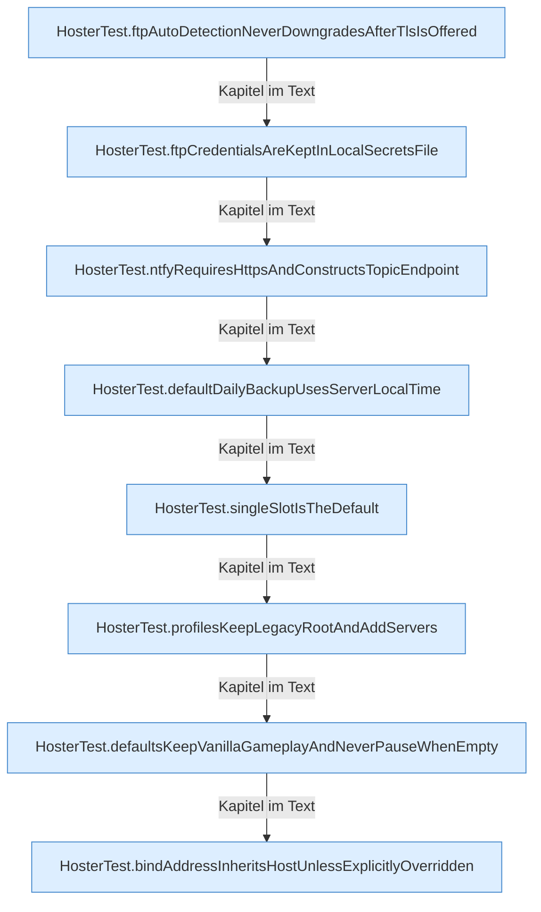

[[00 Start]] › [[Tests]] › [[HosterTest]] › [[HosterTest.Teil1]]

# HosterTest.Teil1



```knoten
HosterTest.ftpAutoDetectionNeverDowngradesAfterTlsIsOffered
  Ein Schritt in einem [[Glossar#Probelauf|Probelauf]]. Er gehört nicht zum laufenden Server. Im [[Glossar#Quelltext|Quelltext]] heißt das `ftpAutoDetectionNeverDowngradesAfterTlsIsOffered`.
HosterTest.ftpCredentialsAreKeptInLocalSecretsFile
  Ein Schritt in einem [[Glossar#Probelauf|Probelauf]]. Er gehört nicht zum laufenden Server. Im [[Glossar#Quelltext|Quelltext]] heißt das `ftpCredentialsAreKeptInLocalSecretsFile`.
HosterTest.ntfyRequiresHttpsAndConstructsTopicEndpoint
  Ein Schritt in einem [[Glossar#Probelauf|Probelauf]]. Er gehört nicht zum laufenden Server. Im [[Glossar#Quelltext|Quelltext]] heißt das `ntfyRequiresHttpsAndConstructsTopicEndpoint`.
HosterTest.defaultDailyBackupUsesServerLocalTime
  Ein Schritt in einem [[Glossar#Probelauf|Probelauf]]. Er gehört nicht zum laufenden Server. Im [[Glossar#Quelltext|Quelltext]] heißt das `defaultDailyBackupUsesServerLocalTime`.
HosterTest.singleSlotIsTheDefault
  Ein Schritt in einem [[Glossar#Probelauf|Probelauf]]. Er gehört nicht zum laufenden Server. Im [[Glossar#Quelltext|Quelltext]] heißt das `singleSlotIsTheDefault`.
HosterTest.profilesKeepLegacyRootAndAddServers
  Ein Schritt in einem [[Glossar#Probelauf|Probelauf]]. Er gehört nicht zum laufenden Server. Im [[Glossar#Quelltext|Quelltext]] heißt das `profilesKeepLegacyRootAndAddServers`.
HosterTest.defaultsKeepVanillaGameplayAndNeverPauseWhenEmpty
  Ein Schritt in einem [[Glossar#Probelauf|Probelauf]]. Er gehört nicht zum laufenden Server. Im [[Glossar#Quelltext|Quelltext]] heißt das `defaultsKeepVanillaGameplayAndNeverPauseWhenEmpty`.
HosterTest.bindAddressInheritsHostUnlessExplicitlyOverridden
  Ein Schritt in einem [[Glossar#Probelauf|Probelauf]]. Er gehört nicht zum laufenden Server. Im [[Glossar#Quelltext|Quelltext]] heißt das `bindAddressInheritsHostUnlessExplicitlyOverridden`.
```

> [!knoten]- Was die Blöcke tun
> - **HosterTest.ftpAutoDetectionNeverDowngradesAfterTlsIsOffered**: Ein Schritt in einem [[Glossar#Probelauf|Probelauf]]. Er gehört nicht zum laufenden Server. Im [[Glossar#Quelltext|Quelltext]] heißt das `ftpAutoDetectionNeverDowngradesAfterTlsIsOffered`.
> - **HosterTest.ftpCredentialsAreKeptInLocalSecretsFile**: Ein Schritt in einem [[Glossar#Probelauf|Probelauf]]. Er gehört nicht zum laufenden Server. Im [[Glossar#Quelltext|Quelltext]] heißt das `ftpCredentialsAreKeptInLocalSecretsFile`.
> - **HosterTest.ntfyRequiresHttpsAndConstructsTopicEndpoint**: Ein Schritt in einem [[Glossar#Probelauf|Probelauf]]. Er gehört nicht zum laufenden Server. Im [[Glossar#Quelltext|Quelltext]] heißt das `ntfyRequiresHttpsAndConstructsTopicEndpoint`.
> - **HosterTest.defaultDailyBackupUsesServerLocalTime**: Ein Schritt in einem [[Glossar#Probelauf|Probelauf]]. Er gehört nicht zum laufenden Server. Im [[Glossar#Quelltext|Quelltext]] heißt das `defaultDailyBackupUsesServerLocalTime`.
> - **HosterTest.singleSlotIsTheDefault**: Ein Schritt in einem [[Glossar#Probelauf|Probelauf]]. Er gehört nicht zum laufenden Server. Im [[Glossar#Quelltext|Quelltext]] heißt das `singleSlotIsTheDefault`.
> - **HosterTest.profilesKeepLegacyRootAndAddServers**: Ein Schritt in einem [[Glossar#Probelauf|Probelauf]]. Er gehört nicht zum laufenden Server. Im [[Glossar#Quelltext|Quelltext]] heißt das `profilesKeepLegacyRootAndAddServers`.
> - **HosterTest.defaultsKeepVanillaGameplayAndNeverPauseWhenEmpty**: Ein Schritt in einem [[Glossar#Probelauf|Probelauf]]. Er gehört nicht zum laufenden Server. Im [[Glossar#Quelltext|Quelltext]] heißt das `defaultsKeepVanillaGameplayAndNeverPauseWhenEmpty`.
> - **HosterTest.bindAddressInheritsHostUnlessExplicitlyOverridden**: Ein Schritt in einem [[Glossar#Probelauf|Probelauf]]. Er gehört nicht zum laufenden Server. Im [[Glossar#Quelltext|Quelltext]] heißt das `bindAddressInheritsHostUnlessExplicitlyOverridden`.

- Ein weiterer Abschnitt derselben Übersicht.
