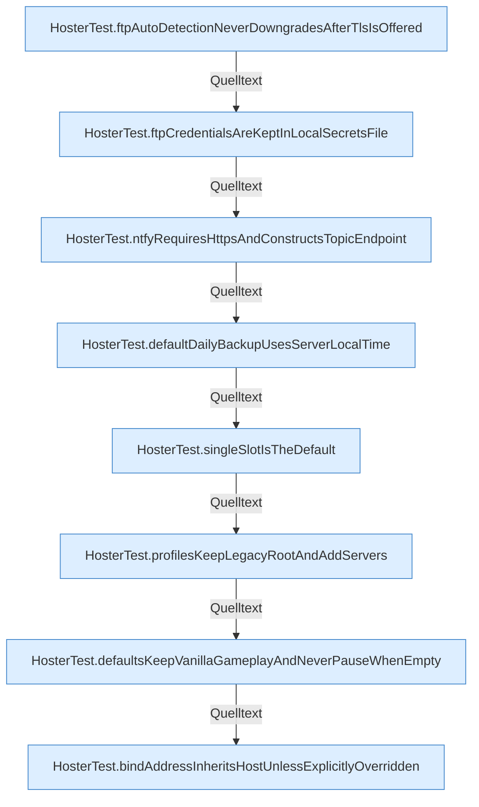

[[00 Start]] › [[Tests]] › [[HosterTest]] › [[HosterTest.Teil1]]

# HosterTest.Teil1



```knoten
HosterTest.ftpAutoDetectionNeverDowngradesAfterTlsIsOffered
  `ftpAutoDetectionNeverDowngradesAfterTlsIsOffered` in `HosterTest.java`. Ruft `unsupportedAuthTls`. Nur Test.
HosterTest.ftpCredentialsAreKeptInLocalSecretsFile
  `ftpCredentialsAreKeptInLocalSecretsFile` in `HosterTest.java`. Ruft `load`. Nur Test.
HosterTest.ntfyRequiresHttpsAndConstructsTopicEndpoint
  `ntfyRequiresHttpsAndConstructsTopicEndpoint` in `HosterTest.java`. Ruft `target`. Nur Test.
HosterTest.defaultDailyBackupUsesServerLocalTime
  `defaultDailyBackupUsesServerLocalTime` in `HosterTest.java`. Ruft `load`. Nur Test.
HosterTest.singleSlotIsTheDefault
  `singleSlotIsTheDefault` in `HosterTest.java`. Nur Test.
HosterTest.profilesKeepLegacyRootAndAddServers
  Liefert die Profile `profilesKeepLegacyRootAndAddServers`. Ruft `load`, `directory`, `focus`. Nur Test.
HosterTest.defaultsKeepVanillaGameplayAndNeverPauseWhenEmpty
  `defaultsKeepVanillaGameplayAndNeverPauseWhenEmpty` in `HosterTest.java`. Ruft `load`, `forcedProperties`, `updateProperties`. Nur Test.
HosterTest.bindAddressInheritsHostUnlessExplicitlyOverridden
  Bindet `bindAddressInheritsHostUnlessExplicitlyOverridden`. Ruft `effectiveBindAddress`, `load`, `forcedProperties`. Nur Test.
```


