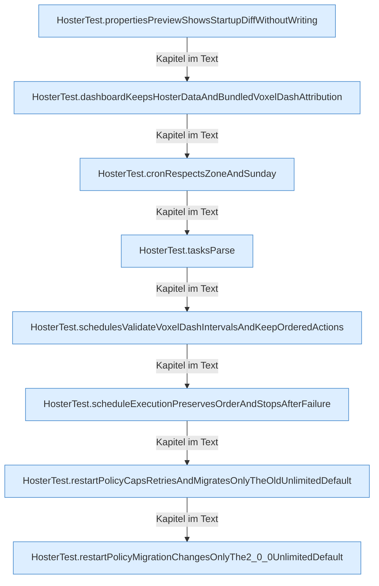

[[00 Start]] › [[Tests]] › [[HosterTest]] › [[HosterTest.Teil2]]

# HosterTest.Teil2



```knoten
HosterTest.propertiesPreviewShowsStartupDiffWithoutWriting
  Ein Schritt in einem [[Glossar#Probelauf|Probelauf]]. Er gehört nicht zum laufenden Server. Im [[Glossar#Quelltext|Quelltext]] heißt das `propertiesPreviewShowsStartupDiffWithoutWriting`.
HosterTest.dashboardKeepsHosterDataAndBundledVoxelDashAttribution
  Ein Schritt in einem [[Glossar#Probelauf|Probelauf]]. Er gehört nicht zum laufenden Server. Im [[Glossar#Quelltext|Quelltext]] heißt das `dashboardKeepsHosterDataAndBundledVoxelDashAttribution`.
HosterTest.cronRespectsZoneAndSunday
  Ein Schritt in einem [[Glossar#Probelauf|Probelauf]]. Er gehört nicht zum laufenden Server. Im [[Glossar#Quelltext|Quelltext]] heißt das `cronRespectsZoneAndSunday`.
HosterTest.tasksParse
  Ein Schritt in einem [[Glossar#Probelauf|Probelauf]]. Er gehört nicht zum laufenden Server. Im [[Glossar#Quelltext|Quelltext]] heißt das `tasksParse`.
HosterTest.schedulesValidateVoxelDashIntervalsAndKeepOrderedActions
  Ein Schritt in einem [[Glossar#Probelauf|Probelauf]]. Er gehört nicht zum laufenden Server. Im [[Glossar#Quelltext|Quelltext]] heißt das `schedulesValidateVoxelDashIntervalsAndKeepOrderedActions`.
HosterTest.scheduleExecutionPreservesOrderAndStopsAfterFailure
  Ein Schritt in einem [[Glossar#Probelauf|Probelauf]]. Er gehört nicht zum laufenden Server. Im [[Glossar#Quelltext|Quelltext]] heißt das `scheduleExecutionPreservesOrderAndStopsAfterFailure`.
HosterTest.restartPolicyCapsRetriesAndMigratesOnlyTheOldUnlimitedDefault
  Ein Schritt in einem [[Glossar#Probelauf|Probelauf]]. Er gehört nicht zum laufenden Server. Im [[Glossar#Quelltext|Quelltext]] heißt das `restartPolicyCapsRetriesAndMigratesOnlyTheOldUnlimitedDefault`.
HosterTest.restartPolicyMigrationChangesOnlyThe2_0_0UnlimitedDefault
  Ein Schritt in einem [[Glossar#Probelauf|Probelauf]]. Er gehört nicht zum laufenden Server. Im [[Glossar#Quelltext|Quelltext]] heißt das `restartPolicyMigrationChangesOnlyThe2_0_0UnlimitedDefault`.
```

> [!knoten]- Was die Blöcke tun
> - **HosterTest.propertiesPreviewShowsStartupDiffWithoutWriting**: Ein Schritt in einem [[Glossar#Probelauf|Probelauf]]. Er gehört nicht zum laufenden Server. Im [[Glossar#Quelltext|Quelltext]] heißt das `propertiesPreviewShowsStartupDiffWithoutWriting`.
> - **HosterTest.dashboardKeepsHosterDataAndBundledVoxelDashAttribution**: Ein Schritt in einem [[Glossar#Probelauf|Probelauf]]. Er gehört nicht zum laufenden Server. Im [[Glossar#Quelltext|Quelltext]] heißt das `dashboardKeepsHosterDataAndBundledVoxelDashAttribution`.
> - **HosterTest.cronRespectsZoneAndSunday**: Ein Schritt in einem [[Glossar#Probelauf|Probelauf]]. Er gehört nicht zum laufenden Server. Im [[Glossar#Quelltext|Quelltext]] heißt das `cronRespectsZoneAndSunday`.
> - **HosterTest.tasksParse**: Ein Schritt in einem [[Glossar#Probelauf|Probelauf]]. Er gehört nicht zum laufenden Server. Im [[Glossar#Quelltext|Quelltext]] heißt das `tasksParse`.
> - **HosterTest.schedulesValidateVoxelDashIntervalsAndKeepOrderedActions**: Ein Schritt in einem [[Glossar#Probelauf|Probelauf]]. Er gehört nicht zum laufenden Server. Im [[Glossar#Quelltext|Quelltext]] heißt das `schedulesValidateVoxelDashIntervalsAndKeepOrderedActions`.
> - **HosterTest.scheduleExecutionPreservesOrderAndStopsAfterFailure**: Ein Schritt in einem [[Glossar#Probelauf|Probelauf]]. Er gehört nicht zum laufenden Server. Im [[Glossar#Quelltext|Quelltext]] heißt das `scheduleExecutionPreservesOrderAndStopsAfterFailure`.
> - **HosterTest.restartPolicyCapsRetriesAndMigratesOnlyTheOldUnlimitedDefault**: Ein Schritt in einem [[Glossar#Probelauf|Probelauf]]. Er gehört nicht zum laufenden Server. Im [[Glossar#Quelltext|Quelltext]] heißt das `restartPolicyCapsRetriesAndMigratesOnlyTheOldUnlimitedDefault`.
> - **HosterTest.restartPolicyMigrationChangesOnlyThe2_0_0UnlimitedDefault**: Ein Schritt in einem [[Glossar#Probelauf|Probelauf]]. Er gehört nicht zum laufenden Server. Im [[Glossar#Quelltext|Quelltext]] heißt das `restartPolicyMigrationChangesOnlyThe2_0_0UnlimitedDefault`.

- Ein weiterer Abschnitt derselben Übersicht.
