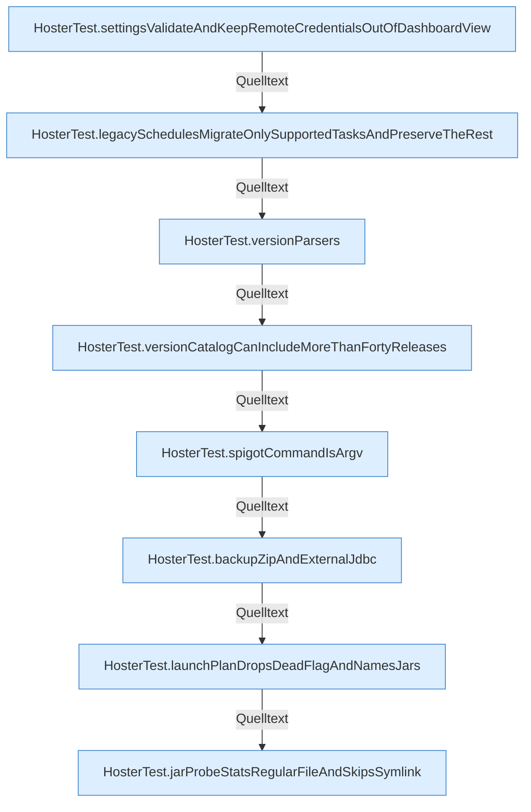

[[00 Start]] › [[Tests]] › [[HosterTest]] › [[HosterTest.Teil3]]

# HosterTest.Teil3



```knoten
HosterTest.settingsValidateAndKeepRemoteCredentialsOutOfDashboardView
  `settingsValidateAndKeepRemoteCredentialsOutOfDashboardView` in `HosterTest.java`. Ruft `ServerHosterSettings`, `view`, `apply`. Nur Test.
HosterTest.legacySchedulesMigrateOnlySupportedTasksAndPreserveTheRest
  `legacySchedulesMigrateOnlySupportedTasksAndPreserveTheRest` in `HosterTest.java`. Ruft `migrate`, `load`. Nur Test.
HosterTest.versionParsers
  `versionParsers` in `HosterTest.java`. Ruft `vanilla`, `fabric`, `paper`. Nur Test.
HosterTest.versionCatalogCanIncludeMoreThanFortyReleases
  `versionCatalogCanIncludeMoreThanFortyReleases` in `HosterTest.java`. Ruft `vanilla`. Nur Test.
HosterTest.spigotCommandIsArgv
  `spigotCommandIsArgv` in `HosterTest.java`. Ruft `command`, `assertRev`. Nur Test.
HosterTest.backupZipAndExternalJdbc
  Sichert `backupZipAndExternalJdbc`. Ruft `tryCreateSymbolicLink`, `archive`, `count`. Nur Test.
HosterTest.launchPlanDropsDeadFlagAndNamesJars
  Startet den Prozess `launchPlanDropsDeadFlagAndNamesJars`. Ruft `profile`, `argv`, `jarName`. Nur Test.
HosterTest.jarProbeStatsRegularFileAndSkipsSymlink
  Betrifft das Jar `jarProbeStatsRegularFileAndSkipsSymlink`. Ruft `profile`, `inspect`, `text`. Nur Test.
```


