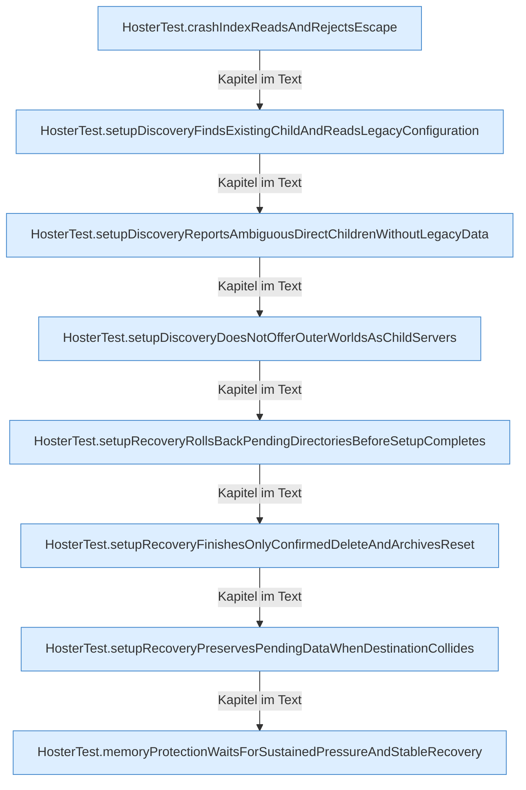

[[00 Start]] › [[Tests]] › [[HosterTest]] › [[HosterTest.Teil4]]

# HosterTest.Teil4



```knoten
HosterTest.crashIndexReadsAndRejectsEscape
  Ein Schritt in einem [[Glossar#Probelauf|Probelauf]]. Er gehört nicht zum laufenden Server. Im [[Glossar#Quelltext|Quelltext]] heißt das `crashIndexReadsAndRejectsEscape`.
HosterTest.setupDiscoveryFindsExistingChildAndReadsLegacyConfiguration
  Ein Schritt in einem [[Glossar#Probelauf|Probelauf]]. Er gehört nicht zum laufenden Server. Im [[Glossar#Quelltext|Quelltext]] heißt das `setupDiscoveryFindsExistingChildAndReadsLegacyConfiguration`.
HosterTest.setupDiscoveryReportsAmbiguousDirectChildrenWithoutLegacyData
  Ein Schritt in einem [[Glossar#Probelauf|Probelauf]]. Er gehört nicht zum laufenden Server. Im [[Glossar#Quelltext|Quelltext]] heißt das `setupDiscoveryReportsAmbiguousDirectChildrenWithoutLegacyData`.
HosterTest.setupDiscoveryDoesNotOfferOuterWorldsAsChildServers
  Ein Schritt in einem [[Glossar#Probelauf|Probelauf]]. Er gehört nicht zum laufenden Server. Im [[Glossar#Quelltext|Quelltext]] heißt das `setupDiscoveryDoesNotOfferOuterWorldsAsChildServers`.
HosterTest.setupRecoveryRollsBackPendingDirectoriesBeforeSetupCompletes
  Ein Schritt in einem [[Glossar#Probelauf|Probelauf]]. Er gehört nicht zum laufenden Server. Im [[Glossar#Quelltext|Quelltext]] heißt das `setupRecoveryRollsBackPendingDirectoriesBeforeSetupCompletes`.
HosterTest.setupRecoveryFinishesOnlyConfirmedDeleteAndArchivesReset
  Ein Schritt in einem [[Glossar#Probelauf|Probelauf]]. Er gehört nicht zum laufenden Server. Im [[Glossar#Quelltext|Quelltext]] heißt das `setupRecoveryFinishesOnlyConfirmedDeleteAndArchivesReset`.
HosterTest.setupRecoveryPreservesPendingDataWhenDestinationCollides
  Ein Schritt in einem [[Glossar#Probelauf|Probelauf]]. Er gehört nicht zum laufenden Server. Im [[Glossar#Quelltext|Quelltext]] heißt das `setupRecoveryPreservesPendingDataWhenDestinationCollides`.
HosterTest.memoryProtectionWaitsForSustainedPressureAndStableRecovery
  Ein Schritt in einem [[Glossar#Probelauf|Probelauf]]. Er gehört nicht zum laufenden Server. Im [[Glossar#Quelltext|Quelltext]] heißt das `memoryProtectionWaitsForSustainedPressureAndStableRecovery`.
```

> [!knoten]- Was die Blöcke tun
> - **HosterTest.crashIndexReadsAndRejectsEscape**: Ein Schritt in einem [[Glossar#Probelauf|Probelauf]]. Er gehört nicht zum laufenden Server. Im [[Glossar#Quelltext|Quelltext]] heißt das `crashIndexReadsAndRejectsEscape`.
> - **HosterTest.setupDiscoveryFindsExistingChildAndReadsLegacyConfiguration**: Ein Schritt in einem [[Glossar#Probelauf|Probelauf]]. Er gehört nicht zum laufenden Server. Im [[Glossar#Quelltext|Quelltext]] heißt das `setupDiscoveryFindsExistingChildAndReadsLegacyConfiguration`.
> - **HosterTest.setupDiscoveryReportsAmbiguousDirectChildrenWithoutLegacyData**: Ein Schritt in einem [[Glossar#Probelauf|Probelauf]]. Er gehört nicht zum laufenden Server. Im [[Glossar#Quelltext|Quelltext]] heißt das `setupDiscoveryReportsAmbiguousDirectChildrenWithoutLegacyData`.
> - **HosterTest.setupDiscoveryDoesNotOfferOuterWorldsAsChildServers**: Ein Schritt in einem [[Glossar#Probelauf|Probelauf]]. Er gehört nicht zum laufenden Server. Im [[Glossar#Quelltext|Quelltext]] heißt das `setupDiscoveryDoesNotOfferOuterWorldsAsChildServers`.
> - **HosterTest.setupRecoveryRollsBackPendingDirectoriesBeforeSetupCompletes**: Ein Schritt in einem [[Glossar#Probelauf|Probelauf]]. Er gehört nicht zum laufenden Server. Im [[Glossar#Quelltext|Quelltext]] heißt das `setupRecoveryRollsBackPendingDirectoriesBeforeSetupCompletes`.
> - **HosterTest.setupRecoveryFinishesOnlyConfirmedDeleteAndArchivesReset**: Ein Schritt in einem [[Glossar#Probelauf|Probelauf]]. Er gehört nicht zum laufenden Server. Im [[Glossar#Quelltext|Quelltext]] heißt das `setupRecoveryFinishesOnlyConfirmedDeleteAndArchivesReset`.
> - **HosterTest.setupRecoveryPreservesPendingDataWhenDestinationCollides**: Ein Schritt in einem [[Glossar#Probelauf|Probelauf]]. Er gehört nicht zum laufenden Server. Im [[Glossar#Quelltext|Quelltext]] heißt das `setupRecoveryPreservesPendingDataWhenDestinationCollides`.
> - **HosterTest.memoryProtectionWaitsForSustainedPressureAndStableRecovery**: Ein Schritt in einem [[Glossar#Probelauf|Probelauf]]. Er gehört nicht zum laufenden Server. Im [[Glossar#Quelltext|Quelltext]] heißt das `memoryProtectionWaitsForSustainedPressureAndStableRecovery`.

- Ein weiterer Abschnitt derselben Übersicht.
