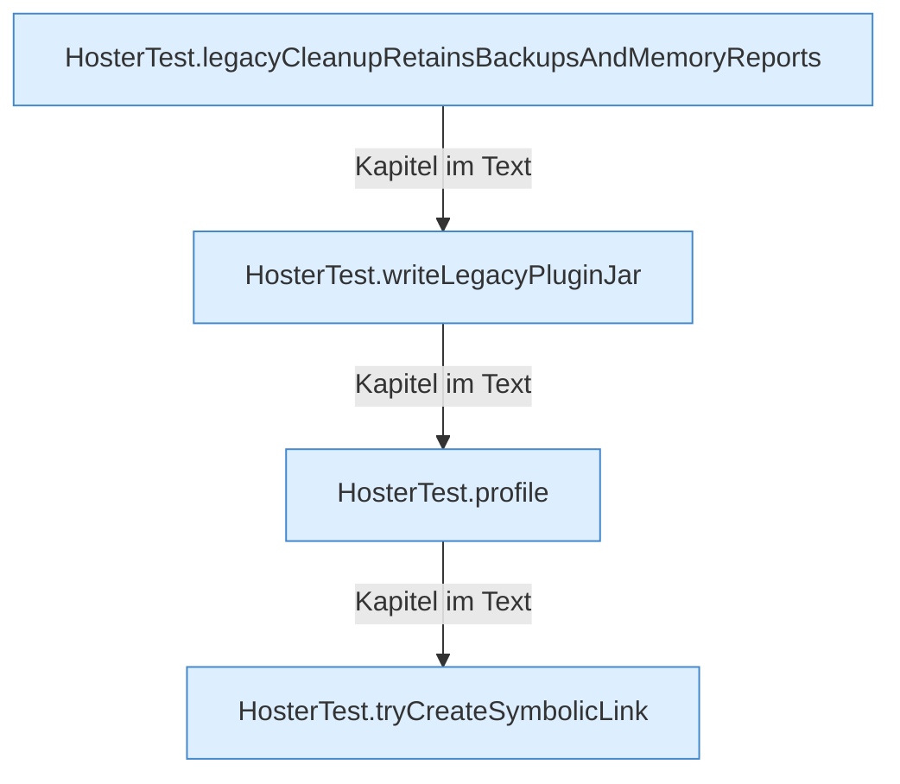

[[00 Start]] › [[Tests]] › [[HosterTest]] › [[HosterTest.Teil5]]

# HosterTest.Teil5



```knoten
HosterTest.legacyCleanupRetainsBackupsAndMemoryReports
  Ein Schritt in einem [[Glossar#Probelauf|Probelauf]]. Er gehört nicht zum laufenden Server. Im [[Glossar#Quelltext|Quelltext]] heißt das `legacyCleanupRetainsBackupsAndMemoryReports`.
HosterTest.writeLegacyPluginJar
  Ein Schritt in einem [[Glossar#Probelauf|Probelauf]]. Er gehört nicht zum laufenden Server. Im [[Glossar#Quelltext|Quelltext]] heißt das `writeLegacyPluginJar`.
HosterTest.profile
  Ein Schritt in einem [[Glossar#Probelauf|Probelauf]]. Er gehört nicht zum laufenden Server. Im [[Glossar#Quelltext|Quelltext]] heißt das `profile`.
HosterTest.tryCreateSymbolicLink
  Ein Schritt in einem [[Glossar#Probelauf|Probelauf]]. Er gehört nicht zum laufenden Server. Im [[Glossar#Quelltext|Quelltext]] heißt das `tryCreateSymbolicLink`.
```

> [!knoten]- Was die Blöcke tun
> - **HosterTest.legacyCleanupRetainsBackupsAndMemoryReports**: Ein Schritt in einem [[Glossar#Probelauf|Probelauf]]. Er gehört nicht zum laufenden Server. Im [[Glossar#Quelltext|Quelltext]] heißt das `legacyCleanupRetainsBackupsAndMemoryReports`.
> - **HosterTest.writeLegacyPluginJar**: Ein Schritt in einem [[Glossar#Probelauf|Probelauf]]. Er gehört nicht zum laufenden Server. Im [[Glossar#Quelltext|Quelltext]] heißt das `writeLegacyPluginJar`.
> - **HosterTest.profile**: Ein Schritt in einem [[Glossar#Probelauf|Probelauf]]. Er gehört nicht zum laufenden Server. Im [[Glossar#Quelltext|Quelltext]] heißt das `profile`.
> - **HosterTest.tryCreateSymbolicLink**: Ein Schritt in einem [[Glossar#Probelauf|Probelauf]]. Er gehört nicht zum laufenden Server. Im [[Glossar#Quelltext|Quelltext]] heißt das `tryCreateSymbolicLink`.

- Ein weiterer Abschnitt derselben Übersicht.
