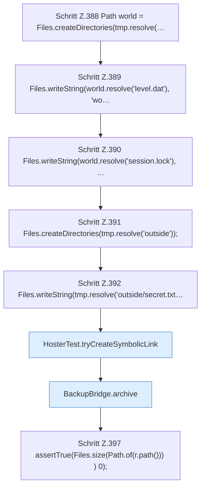

[[00 Start]] › [[Tests]] › [[HosterTest]] › [[HosterTest.Teil3]] › [[HosterTest.backupZipAndExternalJdbc]] › [[HosterTest.backupZipAndExternalJdbc.Teil1]]

# HosterTest.backupZipAndExternalJdbc.Teil1



```knoten
Schritt Z.388 Path world = Files.createDirectories(tmp.resolve(…
  Zeile 388: Dateioperation. `Path world = Files.createDirectories(tmp.resolve(…`
Schritt Z.389 Files.writeString(world.resolve('level.dat'), 'wo…
  Zeile 389: schreibt Text in eine Datei. `Files.writeString(world.resolve('level.dat'), 'wo…`
Schritt Z.390 Files.writeString(world.resolve('session.lock'), …
  Zeile 390: schreibt Text in eine Datei. `Files.writeString(world.resolve('session.lock'), …`
Schritt Z.391 Files.createDirectories(tmp.resolve('outside'));
  Zeile 391: Dateioperation. `Files.createDirectories(tmp.resolve('outside'));`
Schritt Z.392 Files.writeString(tmp.resolve('outside/secret.txt…
  Zeile 392: schreibt Text in eine Datei. `Files.writeString(tmp.resolve('outside/secret.txt…`
HosterTest.tryCreateSymbolicLink
  `tryCreateSymbolicLink` in `HosterTest.java`. Nur Test.
BackupBridge.archive
  Packt `archive`. Ruft `open`, `safeId`, `resolve`.
Schritt Z.397 assertTrue(Files.size(Path.of(r.path())) ) 0);
  Zeile 397: Dateioperation. `assertTrue(Files.size(Path.of(r.path())) ) 0);`
```

- Fortsetzung von `HosterTest.backupZipAndExternalJdbc`, Quellreihenfolge.
