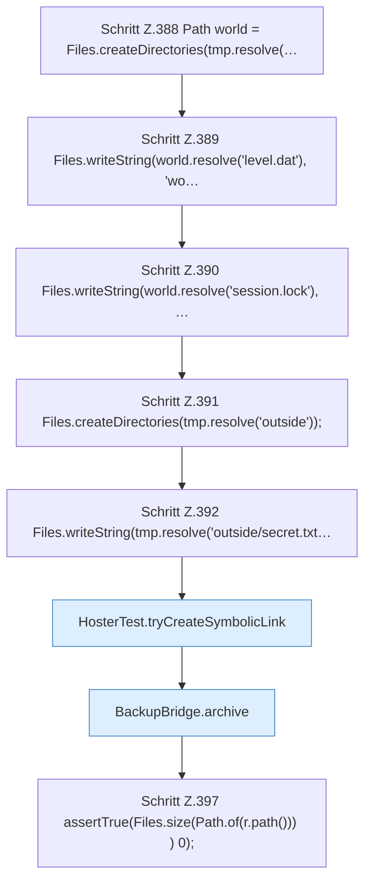

[[00 Start]] › [[Tests]] › [[HosterTest]] › [[HosterTest.Teil3]] › [[HosterTest.backupZipAndExternalJdbc]] › [[HosterTest.backupZipAndExternalJdbc.Teil1]]

# HosterTest.backupZipAndExternalJdbc.Teil1

- Fortsetzung von `HosterTest.backupZipAndExternalJdbc`, Quellreihenfolge.
