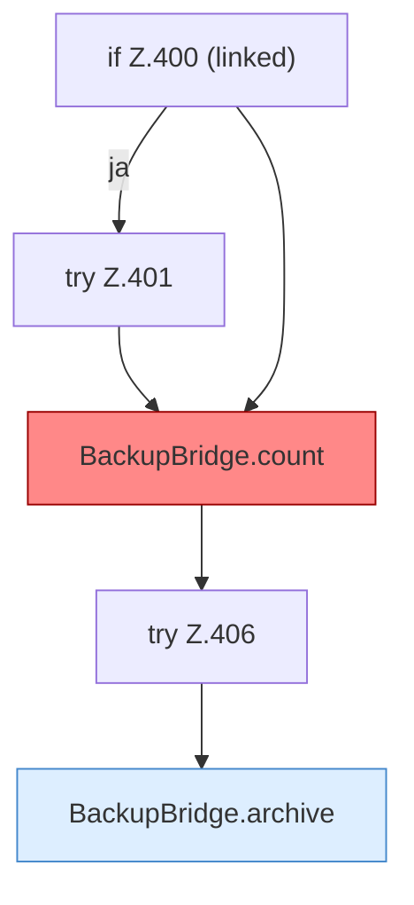

[[00 Start]] › [[Tests]] › [[HosterTest]] › [[HosterTest.Teil3]] › [[HosterTest.backupZipAndExternalJdbc]] › [[HosterTest.backupZipAndExternalJdbc.Teil2]]

# HosterTest.backupZipAndExternalJdbc.Teil2



```knoten
if Z.400 (linked)
  Zeile 400: prüft `(linked)`.
try Z.401
  Zeile 401: Versuch. Der Fehlerpfad geht in catch.
BackupBridge.count
  Die Sicherung auf diesem Rechner zählt das. Zählt `count`. Ruft `connect`, `table`. [[Glossar#Befund|Befund]]: toter Code, wahrscheinlich. src/main/java/de/aichele/childlauncher/BackupBridge.java:241–246 nur von Tests erreicht
try Z.406
  Zeile 406: Versuch. Der Fehlerpfad geht in catch.
BackupBridge.archive
  Die Sicherung auf diesem Rechner macht hier einen einzelnen Schritt. Eine Ebene tiefer steht er genauer. Packt `archive`. Ruft `open`, `safeId`, `resolve`.
```

> [!knoten]- Was die Blöcke tun
> - **if Z.400 (linked)**: Zeile 400: prüft `(linked)`.
> - **try Z.401**: Zeile 401: Versuch. Der Fehlerpfad geht in catch.
> - **BackupBridge.count**: Die Sicherung auf diesem Rechner zählt das. Zählt `count`. Ruft `connect`, `table`. [[Glossar#Befund|Befund]]: toter Code, wahrscheinlich. src/main/java/de/aichele/childlauncher/BackupBridge.java:241–246 nur von Tests erreicht
> - **try Z.406**: Zeile 406: Versuch. Der Fehlerpfad geht in catch.
> - **BackupBridge.archive**: Die Sicherung auf diesem Rechner macht hier einen einzelnen Schritt. Eine Ebene tiefer steht er genauer. Packt `archive`. Ruft `open`, `safeId`, `resolve`.

- Ein weiterer Abschnitt derselben Übersicht.
- Fortsetzung von `HosterTest.backupZipAndExternalJdbc`.
