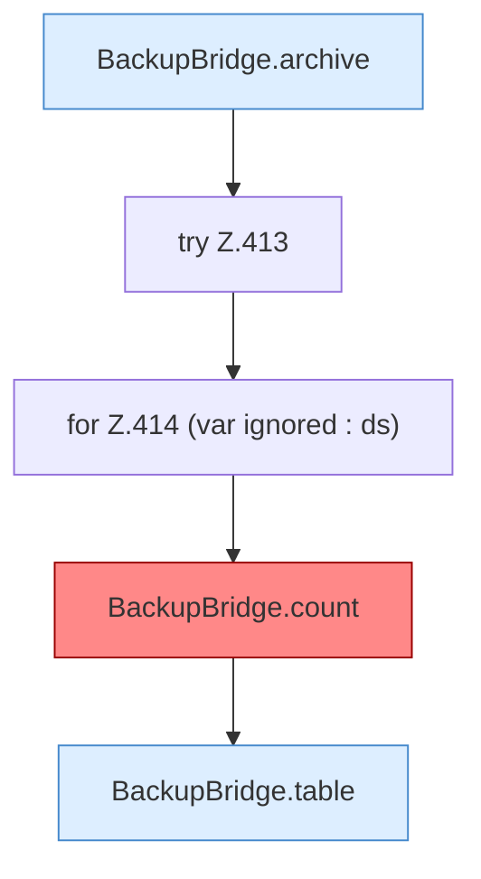

[[00 Start]] › [[Tests]] › [[HosterTest]] › [[HosterTest.Teil3]] › [[HosterTest.backupZipAndExternalJdbc]] › [[HosterTest.backupZipAndExternalJdbc.Teil3]]

# HosterTest.backupZipAndExternalJdbc.Teil3



```knoten
BackupBridge.archive
  Die Sicherung auf diesem Rechner macht hier einen einzelnen Schritt. Eine Ebene tiefer steht er genauer. Packt `archive`. Ruft `open`, `safeId`, `resolve`.
try Z.413
  Zeile 413: Versuch. Der Fehlerpfad geht in catch.
for Z.414 (var ignored : ds)
  Zeile 414: Schleife `(var ignored : ds)`.
BackupBridge.count
  Die Sicherung auf diesem Rechner zählt das. Zählt `count`. Ruft `connect`, `table`. [[Glossar#Befund|Befund]]: toter Code, wahrscheinlich. src/main/java/de/aichele/childlauncher/BackupBridge.java:241–246 nur von Tests erreicht
BackupBridge.table
  Die Sicherung auf diesem Rechner macht hier einen einzelnen Schritt. Eine Ebene tiefer steht er genauer. `table` in `BackupBridge.java`.
```

> [!knoten]- Was die Blöcke tun
> - **BackupBridge.archive**: Die Sicherung auf diesem Rechner macht hier einen einzelnen Schritt. Eine Ebene tiefer steht er genauer. Packt `archive`. Ruft `open`, `safeId`, `resolve`.
> - **try Z.413**: Zeile 413: Versuch. Der Fehlerpfad geht in catch.
> - **for Z.414 (var ignored : ds)**: Zeile 414: Schleife `(var ignored : ds)`.
> - **BackupBridge.count**: Die Sicherung auf diesem Rechner zählt das. Zählt `count`. Ruft `connect`, `table`. [[Glossar#Befund|Befund]]: toter Code, wahrscheinlich. src/main/java/de/aichele/childlauncher/BackupBridge.java:241–246 nur von Tests erreicht
> - **BackupBridge.table**: Die Sicherung auf diesem Rechner macht hier einen einzelnen Schritt. Eine Ebene tiefer steht er genauer. `table` in `BackupBridge.java`.

- Ein weiterer Abschnitt derselben Übersicht.
- Fortsetzung von `HosterTest.backupZipAndExternalJdbc`.
