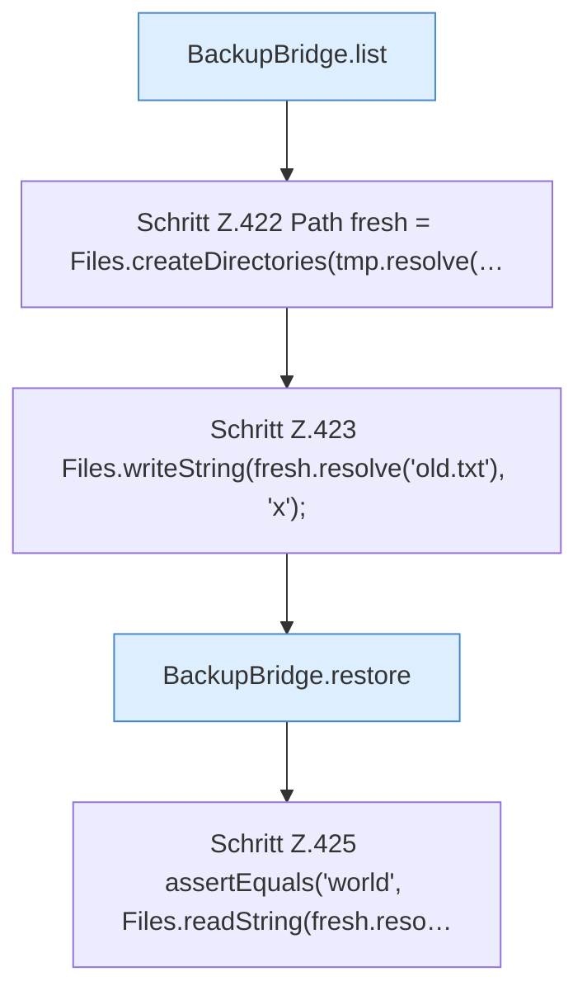

[[00 Start]] › [[Tests]] › [[HosterTest]] › [[HosterTest.Teil3]] › [[HosterTest.backupZipAndExternalJdbc]] › [[HosterTest.backupZipAndExternalJdbc.Teil4]]

# HosterTest.backupZipAndExternalJdbc.Teil4



```knoten
BackupBridge.list
  Listet `list`. Ruft `directory`, `safeId`, `named`.
Schritt Z.422 Path fresh = Files.createDirectories(tmp.resolve(…
  Zeile 422: Dateioperation. `Path fresh = Files.createDirectories(tmp.resolve(…`
Schritt Z.423 Files.writeString(fresh.resolve('old.txt'), 'x');
  Zeile 423: schreibt Text in eine Datei. `Files.writeString(fresh.resolve('old.txt'), 'x');`
BackupBridge.restore
  Stellt wieder her `restore`. Ruft `file`, `restoreZip`.
Schritt Z.425 assertEquals('world', Files.readString(fresh.reso…
  Zeile 425: liest Text aus einer Datei. `assertEquals('world', Files.readString(fresh.reso…`
```

- Fortsetzung von `HosterTest.backupZipAndExternalJdbc`, Quellreihenfolge.
