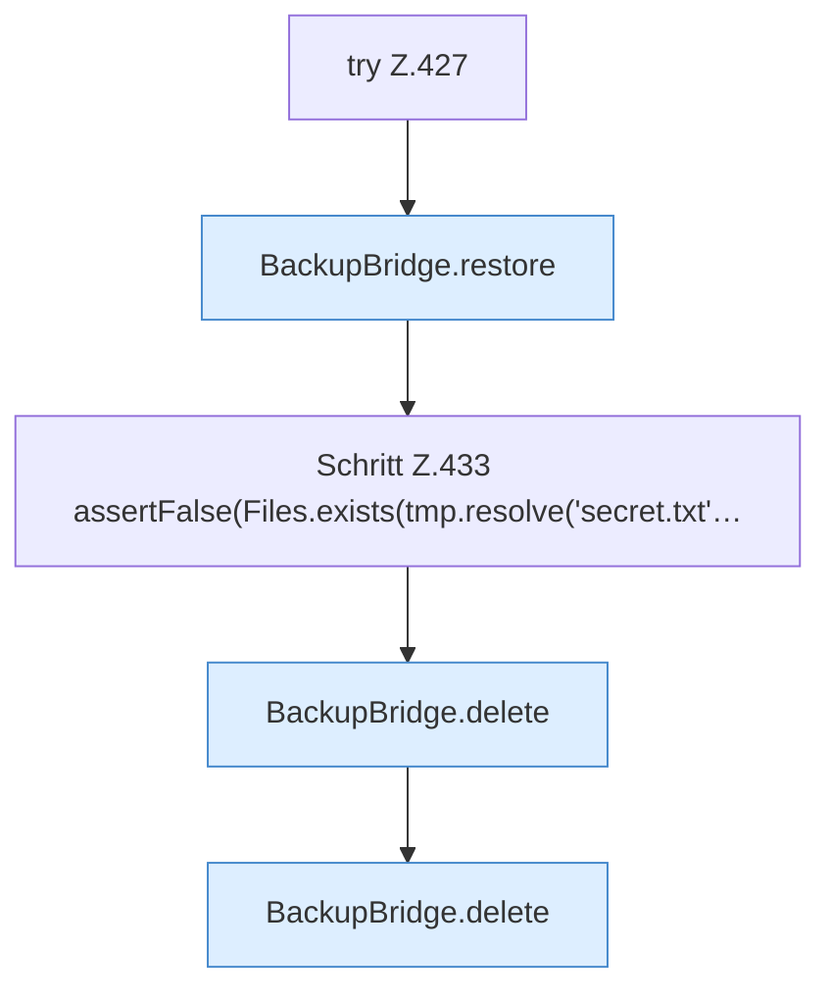

[[00 Start]] › [[Tests]] › [[HosterTest]] › [[HosterTest.Teil3]] › [[HosterTest.backupZipAndExternalJdbc]] › [[HosterTest.backupZipAndExternalJdbc.Teil5]]

# HosterTest.backupZipAndExternalJdbc.Teil5



```knoten
try Z.427
  Zeile 427: Versuch. Der Fehlerpfad geht in catch.
BackupBridge.restore
  Stellt wieder her `restore`. Ruft `file`, `restoreZip`.
Schritt Z.433 assertFalse(Files.exists(tmp.resolve('secret.txt'…
  Zeile 433: Dateioperation. `assertFalse(Files.exists(tmp.resolve('secret.txt'…`
BackupBridge.delete
  Löscht `delete`. Ruft `file`.
```

- Fortsetzung von `HosterTest.backupZipAndExternalJdbc`, Quellreihenfolge.
