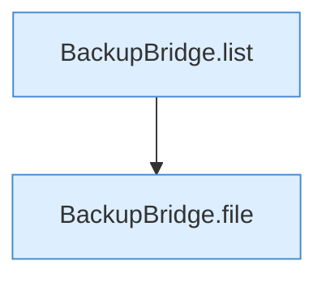

[[00 Start]] › [[Tests]] › [[HosterTest]] › [[HosterTest.Teil3]] › [[HosterTest.backupZipAndExternalJdbc]] › [[HosterTest.backupZipAndExternalJdbc.Teil6]]

# HosterTest.backupZipAndExternalJdbc.Teil6



```knoten
BackupBridge.list
  Listet `list`. Ruft `directory`, `safeId`, `named`.
BackupBridge.file
  Liefert die Datei `file`. Ruft `safeId`, `named`, `directory`.
```

- Fortsetzung von `HosterTest.backupZipAndExternalJdbc`, Quellreihenfolge.
